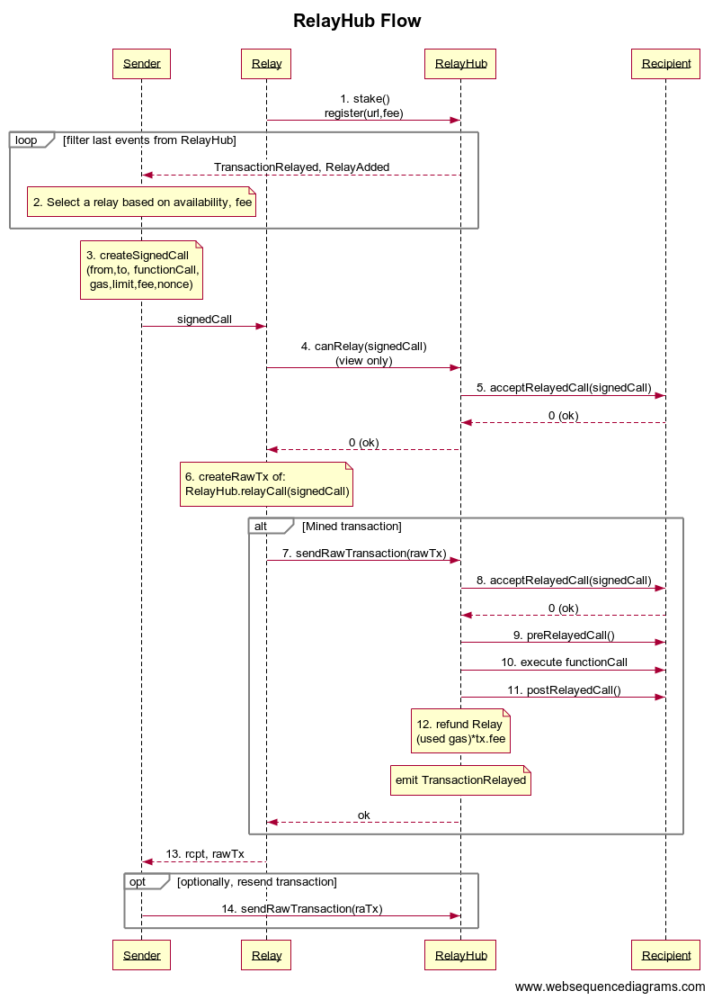

## Abstract

Communicating with dapps currently requires paying ETH for gas, which limits dapp adoption to ether users. 
Therefore, contract owners may wish to pay for the gas to increase user acquisition, or let their users pay for gas with fiat money. 

The Gas Station Network makes smart contracts accessible to non-ether users by allowing contracts to accept "collect-calls", paying for incoming calls.
It lets contracts "listen" on publicly accessible channels (e.g. web URL or a whisper address) and incentivizes nodes to run "gas stations" to facilitate this. 
It requires no network changes and minimal contract changes.

Alternatively, a 3rd party may wish to subsidize the gas costs of certain contracts. 
Solutions could allow transactions from addresses that hold no ETH.

The gas stations network is an effort to solve the problem by creating an incentive for nodes to run gas stations, where gasless transactions can be "fueled up". 
It abstracts the implementation details from both the dapp maintainer and the user, making it easy to convert existing dapps to accept "collect-calls".

The network consists of a single public contract trusted by all participating dapp contracts, and a decentralized network of relay nodes (gas stations) incentivized to listen on non-ether interfaces such as web or whisper, 
pay for transactions and get compensated by that contract. The trusted contract can be verified by anyone, and the system is otherwise trustless. 
Gas stations cannot censor transactions as long as there's at least one honest gas station. Attempts to undermine the system can be proven on-chain and offenders can be penalized.

## Motivation

* Increase user adoption of smart contracts by:
    * Removing the user hassle of acquiring ETH. Transactions are still paid by ETH but costs can be borne by the dapp or paid by the user through other means.
    * Removing the need to interact directly with the blockchain, while maintaining decentralization and censorship-resistance. 
      Contracts can "listen" on multiple public channels, and users can interact with the contracts through common protocols that are generally permitted even in restrictive environments.
* Ethereum nodes get a revenue source without requiring mining equipment. The entire network benefits from having more nodes.
* No protocol changes required. The gas station network is self-organized via a smart contract, and dapps interact with the network by implementing an interface.

## Specification

The Gas Stations Network has two audited major versions referred to below as Version 1 and Version 2.
Both versions follow the same economic model, with version 2 introducing a new acceptance/payment policy and new signature/replay-protection logic.

### Overview

#### How it works

1. A **dapp owner** or a sponsor deposits ETH in the hub, allocated for the contract that will pay.
2. A **sender** with no ETH signs a request describing the call they want to make.
3. A **relay** picks up the request, checks that it will be paid, and submits it to the hub in a transaction, paying the gas.
4. The **hub** verifies the signature and nonce, asks the paying contract to accept, performs the call with the sender's address attached, and transfers the cost plus the relay's fee from the deposit to the relay.
5. The **recipient contract** sees the call as coming from the sender, and not from the relay or hub.

#### Participants

| Term          | Meaning                                                                                                                                                                      |
|---------------|------------------------------------------------------------------------------------------------------------------------------------------------------------------------------|
| **Sender**    | An externally owned account with a valid key pair and no ETH. Signs requests off-chain. The client application acting on its behalf is called the *client*.                  |
| **Payer**     | The contract that agrees to pay for a relayed call and holds the deposit in the hub. In Version 1 this is the recipient itself. In Version 2 it is a separate **Paymaster**. |
| **Recipient** | The contract the sender wants to call.                                                                                                                                       |
| **Relay**     | An operator running an off-chain service that accepts requests from senders and pays gas to submit them. Registered in the hub with a URL and a fee.                         |
| **RelayHub**  | The singleton contract that coordinates everything: relay registry, replay protection, deposits, payments, penalties.                                                        |

#### Versions 1 and 2 differences

|                                 | Version 1                                            | Version 2                                                                        |
|---------------------------------|------------------------------------------------------|----------------------------------------------------------------------------------|
| Structure                       | One `RelayHub`                                       | `RelayHub` + `Forwarder` + `Paymaster` + `StakeManager` + `Penalizer`            |
| Who decides to pay              | The recipient using `acceptRelayedCall`              | A `Paymaster` using `preRelayedCall`, reusable across recipients                 |
| Signature and replay protection | `RelayHub` maintains its own nonce per sender        | `Forwarder` ([EIP-712](./eip-712.md), [ERC-2771](./eip-2771.md))                 |
| Recipient integration           | Inherit `RelayRecipient`, implement acceptance hooks | Trust a forwarder and read the sender per ERC-2771                               |
| Relay identity                  | One address                                          | `relayManager` (holds stake) and `relayWorker` (hot keys that send transactions) |
| Stake                           | Held by the `RelayHub`                               | Held by the `StakeManager`                                                       |

### Version 1

The system consists of a `RelayHub` singleton contract, participating contracts inheriting the `RelayRecipient` contract, a decentralized network of `Relay` nodes, a.k.a. Gas Stations, 
and user applications (e.g. mobile or web) interacting with contracts via relays.

#### The `RelayHub` contract

This is the main registry contract in the Gas Station Network design. It coordinates all participants of the system by fulfilling the following tasks:

* Maintain a list of active relays. Senders select a `Relay` from this list for each transaction. The selection process is discussed below.
* Mediate all communication between relays and contracts.
* Provide contracts with trusted versions of the real msg.sender and msg.data.
* Hold ETH stakes placed by relays. A minimum stake size is enforced.  Stake can be withdrawn after a relay unregisters and waits for a cooldown period.
* Hold ETH prepayments made by contracts and use them to compensate relays.
* Penalize provably-offensive relays by giving their stakes to an address providing the proof, thus keeping relays honest.
* Provide a free way for relays to know whether they'll be compensated for a future transaction.

#### The `Relay` node service

The Relay nodes are the processes observing the `RelayHub` on-chain and interacting with it to fulfill their duties:

* Maintain a hot wallet with a small amount of ETH, to pay for gas.
* Provide a public interface for user apps to send gasless transactions via channels such as https or whisper.
* Publish it's public interfaces and its price (as a multiplier of the actual transaction gas cost) in `RelayHub`.
* Optionally monitor reverted transactions of other relays through RelayHub, catching offending relays and claiming their stakes. This can be done by anyone, not just a relay.

#### The `RelayRecipient` contract

The smart contracts willing to allow their users to invoke them using the Gas Stations Network MUST inherit the `RelayRecipient` contract.

The recipient contract performs the following tasks:

* Know the address of `RelayHub` and trust it to provide information about the transaction.
* Maintain a small balance of ETH gas prepayment deposit in `RelayHub`. Can be paid directly by the `RelayRecipient` contract, or by the dapp's owner on behalf of the `RelayRecipient` address. 
  The dapp owner is responsible for ensuring sufficient balance for the next transactions, and can stop depositing if something goes wrong, thus limiting the potential for abuse of system bugs. In DAO usecases it will be up to the DAO logic to maintain a sufficient deposit.
* Use `getSender()` and `getMessageData()` instead of `msg.sender` and `msg.data`, everywhere. `RelayRecipient` provides these functions and gets the information from `RelayHub`.

```solidity
// Called by RelayHub as a static call, first off-chain by the relays before sending, and then again on-chain.
  function acceptRelayedCall(
      address relay,
      address from,
      bytes calldata encodedFunction,
      uint256 transactionFee,
      uint256 gasPrice,
      uint256 gasLimit,
      uint256 nonce,
      bytes calldata approvalData,
      uint256 maxPossibleCharge
  ) external view returns (uint256 status, bytes memory context);

// Called by RelayHub just before the relayed call. Does nothing by default.
// A revert here reverts the relayed call only and the relay is still compensated.
function preRelayedCall(bytes calldata context) external returns (bytes32);

// Called by RelayHub after the relayed call. Does nothing by default.
function postRelayedCall(bytes calldata context, bool success, uint256 actualCharge, bytes32 preRetVal) external;
```

* `acceptRelayedCall` is a view function that returns a **zero** `status` if and only if it is willing to accept a transaction and pay for it; any other `status` is a failure, interpreted as a dapp-specific error code (values below 10 are reserved by `RelayHub.canRelay`). The returned `context` is opaque to `RelayHub` and is passed verbatim to `preRelayedCall` and `postRelayedCall`, letting the recipient carry state (e.g. the charge it intends to apply) across the three calls without re-deriving it from `encodedFunction`.
  It is called by `RelayHub` as a view function when a `Relay` inquires, and again during the actual transaction. The relayed call is reverted if `status` is **non-zero**, and the `Relay` is compensated for a transaction (whether successful or reverted) only if `acceptRelayedCall` returned **zero**. Some examples of `acceptRelayedCall()` implementations:
    * Whitelist of trusted dapp members.
    * Balance sheet of registered users, maintained by the dapp owner. Users pay the dapp with a credit card or other non-ETH means, and are credited in the `RelayRecipient` balance sheet. 
      Users can never cost the dapp more than they were credited for.
    * A dapp can provide off-chain a signed message called `approvalData` to a transaction sender and validate it.
    * Whitelist of known transactions used for onboarding new users. This allows certain anonymous calls and is subject to Sybil attacks. 
      Therefore it should be combined with a restricted gasPrice, and a whitelist of trusted relays, to reduce the incentive for relays to create bogus transactions and rob the dapp's prepaid gas deposit. 
      Dapps allowing anonymous onboarding transactions might benefit from registering their own `Relay` and accepting anonymous transactions only from that `Relay`, whereas other transactions can be accepted from any relay. 
      Alternatively, dapps may use the balance sheet method for onboarding as well, by applying the methods suggested in the attacks/mitigations section below.   
* `preRelayedCall` is called before a transaction is relayed, and is given the `context` returned by `acceptRelayedCall`. By default, it does nothing. A revert here causes a revert of the relayed call only, not of the whole transaction; the relay still gets compensated.
* `postRelayedCall` is called after a transaction is relayed, and is given `context`, whether the relayed call succeeded, the estimated charge, and `preRelayedCall`'s return value. By default, it does nothing.

#### The `RelayHub` contract's public interface

```solidity
function stake(address relayAddress, uint256 unstakeDelay) external payable;
function registerRelay(uint256 transactionFee, string calldata url) external;
function removeRelayByOwner(address relay) external;
function unstake(address relay) external;
function depositFor(address target) external payable;
function balanceOf(address target) external view returns (uint256);
function withdraw(uint256 amount, address payable dest) external;
function getNonce(address from) external view returns (uint256);

function canRelay(address relay, address from, address to, bytes calldata encodedFunction,
    uint256 transactionFee, uint256 gasPrice, uint256 gasLimit, uint256 nonce,
    bytes calldata signature, bytes calldata approvalData)
    external view returns (uint256 status, bytes memory recipientContext);

function relayCall(address from, address to, bytes calldata encodedFunction,
    uint256 transactionFee, uint256 gasPrice, uint256 gasLimit, uint256 nonce,
    bytes calldata signature, bytes calldata approvalData) external;

function penalizeRepeatedNonce(bytes calldata unsignedTx1, bytes calldata signature1,
    bytes calldata unsignedTx2, bytes calldata signature2) external;

function penalizeIllegalTransaction(bytes calldata unsignedTx, bytes calldata signature) external;

event RelayAdded(address indexed relay, address indexed owner, uint256 transactionFee, uint256 stake, uint256 unstakeDelay, string url);
event RelayRemoved(address indexed relay, uint256 unstakeTime);
event CanRelayFailed(address indexed relay, address indexed from, address indexed to, bytes4 selector, uint256 reason);
event TransactionRelayed(address indexed relay, address indexed from, address indexed to, bytes4 selector, RelayCallStatus status, uint256 charge);
```

`RelayCallStatus` is one of `OK`, `RelayedCallFailed`, `PreRelayedFailed`, `PostRelayedFailed`, `RecipientBalanceChanged`.

#### The process of registering or refreshing a `Relay`

* Relay starts listening as a web app (or on some other communication channel).
* If starting for the first time (no key yet), generate a key pair for Relay's address.
* If Relay's address doesn't hold sufficient funds for gas (e.g. because it was just generated), Relay stays inactive until its owner funds it.
* Relay's owner funds it.
* Relay's owner sends the required stake to `RelayHub` by calling `RelayHub.stake(address relay, uint unstakeDelay)`.
* `RelayHub` puts the `owner` and `unstake delay` in the relays map, indexed by `relay` address.
* Relay calls `RelayHub.registerRelay(uint transactionFee, string memory url)` with the relay's `transaction fee` (as a multiplier on transaction gas cost), and a URL for incoming transactions. 
* `RelayHub` ensures that Relay has a sufficient stake.
* `RelayHub` puts the `transaction fee` in the relays map.
* `RelayHub` emits an event, `RelayAdded(Relay, owner, transactionFee, relayStake, unstakeDelay, url)`.
* Relay starts a timer to perform a `keepalive` transaction every 6000 blocks.
* `Relay` goes to sleep and waits for signing requests.

#### The process of sending a relayed transaction



* `Sender` selects a live `Relay` from RelayHub's list by looking at `RelayAdded` events from `RelayHub`, and sorting based on its own criteria. Selection may be based on a mix of:
    * Relay published transaction fees.
    * Relay stake size and lock-up time.
    * Recent relay transactions (visible through `TransactionRelayed` events from `RelayHub`).
    * Optionally, reputation/blacklist/whitelist held by the sender app itself, or its backend, on per-app basis (not part of the gas stations network).
* Sender prepares the transaction with Sender's address, the recipient address, the actual transaction data, Relay's transaction fee, gas price, gas limit, its current nonce from `RelayHub.getNonce(sender)`, RelayHub's address, and Relay's address, and then signs it.
* Sender verifies that `RelayHub.balanceOf(recipient)` holds enough ETH to pay Relay's fee.
* Sender verifies that `Relay.balance` has enough eth to send the transaction
* Sender reads the Relay's current `nonce` value and decides on the `max_nonce` parameter.
* Sender sends the signed transaction and metadata to Relay's web interface.
* `Relay` wraps the transaction with a transaction to `RelayHub`, with zero ETH value.
* `Relay` signs the wrapper transaction with its key in order to pay for gas.
* `Relay` verifies that:
    * The transaction's recipient contract will accept this transaction when submitted, by calling `RelayHub.canRelay()`, a view function, 
      which checks the recipient's `acceptRelayedCall`, also a view function, stating whether it's willing to accept the charges).
    * The transaction nonce matches `RelayHub.getNonce(sender)`.
    * The relay address in the transaction matches Relay's address.
    * The transaction's recipient has enough ETH deposited in `RelayHub` to pay the transaction fee.
    * Relay has enough ETH to pay for the gas required by the transaction.
    * Value of `max_nonce` is higher than current Relay's `nonce`
* If any of Relay's checks fail, it returns an error to sender, and doesn't proceed.
* Relay submits the signed wrapped transaction to the blockchain.
* Relay immediately returns the signed wrapped transaction to the sender.  This step is discussed below, in attacks/mitigations.
* `Sender` receives the wrapped transaction and verifies that:
    * It's a valid relay call to `RelayHub`, from Relay's address.
    * The transaction's ethereum nonce matches Relay's current nonce.
    * The transaction's ethereum nonce is lower than or equal to `max_nonce`.
    * `Relay` is sufficiently funded to pay for it.
    * The wrapped transaction is valid and signed by `sender`.
    * Recipient contract has sufficient funds in `RelayHub.balanceOf(recipient)` to pay for Relay's fee as stated in the transaction.
* If any of sender's checks fails, it goes back to selecting a new Relay. Sender may also file a report on the unresponsive relay to its backend or save it locally, to down-sort this relay in future transactions.
* `Sender` may also submit the raw wrapped transaction to the blockchain without paying for gas, through any Ethereum node. 
  This submission is likely ignored because an identical transaction is already in the network's pending transactions, but no harm in putting it twice, to ensure that it happens. 
  This step is not strictly necessary, for reasons discussed below in attacks/mitigations, but may speed things up.
* `Sender` monitors the blockchain, waiting for the transaction to be mined. 
  The transaction was verified, with Relay's current nonce, so mining must be successful unless Relay submitted another (different) transaction with the same nonce. 
  If mining fails due to such attack, sender may call `RelayHub.penalizeRepeatedNonce` through another relay, to collect his reward and burn the remainder of the offending relay's stake, and then go back to selecting a new Relay for the transaction. 
  See discussion in the attacks/mitigations section below.
* `RelayHub` receives the transaction:
    * Records `gasleft()` as `initialGas` for later payment.
    * Verifies the transaction is sent from a registered relay.
    * Verifies that the signature of the internal transaction matches its stated origin (sender's key).
    * Verifies that the relay address written in the transaction matches msg.sender.
    * Verifies that the transaction's `nonce` matches the stated origin's nonce, as returned by `RelayHub.getNonce`.
    * Calls recipient's `acceptRelayedCall` function, asking whether it's going to accept the transaction. If not, a `CanRelayFailed` event is emitted carrying `acceptRelayedCall`'s returned status, `TransactionRelayed` is never emitted, and neither `preRelayedCall`, the recipient, nor `postRelayedCall` are called. In this case, Relay doesn't get paid, as it was its responsibility to check `RelayHub.canRelay` before releasing the transaction.
    * Calls recipient's `preRelayedCall` function. If this call reverts the `TransactionRelayed` will be emitted with status `PreRelayedFailed`.
    * Sends the transaction to the recipient.  If this call reverts the `TransactionRelayed` will be emitted with status `RelayedCallFailed`.
      When passing gas to `call()`, enough gas is preserved by `RelayHub`, for post-call handling. Recipient may run out of gas, but `RelayHub` never does. 
      `RelayHub` also sends sender's address at the end of `msg.data`, so `RelayRecipient.getSender()` will be able to extract the real sender, and trust it because the transaction came from the known `RelayHub` address.
* Recipient contract handles the transaction.
* `RelayHub` calls recipient's `postRelayedCall`.
* `RelayHub` checks call's return value of call, and emits `TransactionRelayed(address relay, address from, address to, bytes4 selector, RelayCallStatus status, uint256 charge)`.
* `RelayHub` increases the nonce of the sender, as returned by `RelayHub.getNonce(sender)`.
* `RelayHub` transfers ETH balance from recipient to `Relay.owner`, to pay the transaction fee, based on the measured transaction cost. 
  Note on relay payment: The relay gets paid for actual gas used, regardless of whether the recipient reverted. 
  The only case where the relay sustains a loss, is if `canRelay` returns non-zero, since the relay was responsible to verify this view function prior to submitting. 
  Any other revert is caught and paid for. See attacks/mitigations below.
* `Relay` keeps track of transactions it sent, and waits for `TransactionRelayed` events to see the charge. 
  If a transaction reverts and goes unpaid, which means the recipient's `acceptRelayedCall()` function was inconsistent, `Relay` refuses service to that recipient for a while (or blacklists it indefinitely, if it happens often). 
  See attacks/mitigations below.

#### Winding a relay down

The process of winding a `Relay` down:

* Relay's owner (the address that initially funded it) calls `RelayHub.removeRelayByOwner(Relay)`.
* `RelayHub` ensures that the sender is indeed Relay's owner, then removes `Relay`, and emits `RelayRemoved(Relay)`.
* `RelayHub` starts the countdown towards releasing the owner's stake.
* `Relay` receives its `RelayRemoved` event.
* `Relay` sends all its remaining ETH to its owner.
* `Relay` shuts down.
* Once the owner's unstake delay is over, owner calls `RelayHub.unstake()`, and withdraws the stake.

### Version 2

Version 2 splits the monolithic `RelayHub` into modules, each reusable and separately upgradeable. It also separates *who signs* (`Forwarder`) from *who pays* (`Paymaster`) from *who holds the stake* (`StakeManager`).

| Contract       | Responsibility                                                                                                    |
|----------------|-------------------------------------------------------------------------------------------------------------------|
| `RelayHub`     | Orchestrates a relayed call and pays the relay. Holds deposits and the relay registry.                            |
| `Paymaster`    | Decides whether to pay for a request and settles with its users. Holds a deposit in `RelayHub`.                   |
| `Forwarder`    | Verifies the sender's EIP-712 signature and replay nonce, then forwards the call, appending the sender's address. |
| `StakeManager` | Holds relay stakes and unstake delays, independently of any hub.                                                  |
| `Penalizer`    | Verifies fraud proofs and triggers penalties.                                                                     |

#### The `Forwarder` contract

The `Forwarder` contract verifies the sender's EIP-712 signature and replay-protection nonce, and forwards the call to the recipient contract. It holds no payment or acceptance logic, and is standardized as [ERC-2771](./eip-2771.md).

A **recipient** MUST recognize its trusted forwarder (`isTrustedForwarder`) and read the sender from the last 20 bytes of the call data (`_msgSender()`) when the call comes from it. A recipient MUST NOT trust a forwarder it does not control or audit, since a trusted forwarder can impersonate any sender.

#### The `Paymaster` contracts

The `Paymaster` contracts extract the role of V1's `acceptRelayedCall` and delegate it to a separate entity.
Acceptance and payment policy lives in a standalone contract, so one paymaster can sponsor many recipients and a recipient can switch paymasters without redeployment.

```solidity
struct GasAndDataLimits {
    uint256 acceptanceBudget;
    uint256 preRelayedCallGasLimit;
    uint256 postRelayedCallGasLimit;
    uint256 calldataSizeLimit;
}

function getGasAndDataLimits() external view returns (GasAndDataLimits memory limits);
function trustedForwarder() external view returns (address);

// Called in view mode by the relay and again on-chain by RelayHub. A revert is a rejection.
function preRelayedCall(RelayRequest calldata relayRequest, bytes calldata signature,
    bytes calldata approvalData, uint256 maxPossibleGas)
    external returns (bytes memory context, bool rejectOnRecipientRevert);

// Called after the relayed call. Even if it reverts, the paymaster is still charged.
function postRelayedCall(bytes calldata context, bool success, uint256 gasUseWithoutPost,
    RelayData calldata relayData) external;
```

How the paymaster's choices protect the relay:

* **`acceptanceBudget`** bounds the relay's risk. If a request is rejected within the budget, the relay bears at most that much gas. If processing exceeds it, the paymaster is charged regardless of the outcome. A relay only serves paymasters whose `acceptanceBudget` is within its own `maxAcceptanceBudget`.
* **`rejectOnRecipientRevert`** lets a paymaster treat a reverting recipient call as a rejection (so it is not charged). It is safe only if the paymaster trusts the recipient to revert quickly, because the whole decision must fit in `acceptanceBudget`. If `false`, a reverting recipient is paid for on-chain like any other call.
* **`calldataSizeLimit`** and the pre/post gas limits bound the cost that any single request can impose.

#### `StakeManager`

The `StakeManager` holds relay stakes and unstake delays independently of any one hub, so one stake can, once authorized, back several `RelayHub` deployments.

Only a hub authorized by the stake's owner or manager can reach `penalizeRelayManager`.

#### `Penalizer`

The `Penalizer` holds the fraud-proof logic. `penalizeRepeatedNonce` and `penalizeIllegalTransaction` have the same purpose as in Version 1, but they call into `RelayHub.penalize` and `StakeManager.penalizeRelayManager`, and are guarded by a commit/reveal step so that the reward cannot be front-run.

A penalization is submitted in two steps: `commit` the hash of the penalization call together with the caller's address, wait for the penalizer's block delay, then make the call within its expiration window.

#### `RelayHub`

In Version 2 the hub remains as the core orchestrator of the relaying process.

The `relayCall` invocation passes the request through the `Forwarder` and the `Paymaster` contracts, and charges the total gas fee to the paymaster. The total charge is calculated using the `calculateCharge` function.

Version 2 additionally splits the staked identity and the transaction sender. A `relayManager` owns the stake, registers the relay (`registerRelayServer`), receives payment, and adds `relayWorker` addresses (`addRelayWorkers`). Only registered workers call `relayCall`. A compromised or drained worker key does not expose the stake, and a worker's misbehavior is penalized against its manager's stake.

## Rationale
The rationale for the gas stations network design is a combination of two sets of requirements: Easy adoption, and robustness.

For easy adoption, the design goals are:

* No network changes.
* Minimal changes to contracts, apps and frameworks.

The robustness requirement translates to decentralization and attack resistance. The gas stations network is decentralized, and we have to assume that any entity may attack other entities in the system.

Specifically we've considered the following types of attacks:

* Denial-of-service attacks against individual senders, i.e. transactions censorship.
* Denial-of-service and financial attacks against individual relays.
* Denial-of-service and financial attacks against individual contracts.
* Denial-of-service attacks against the entire network, either by attacking existing entities, or by introducing any number of malicious entities.

## Backwards Compatibility

The Gas Stations Network is implemented as smart contracts and external entities, and does not require any network changes.

Dapps adding gas station network support remain backwards compatible with their existing apps/users. The added methods apply on top of the existing ones, so no changes are required for existing apps.

## Reference Implementation

### Deployments

The network requires at least one active relay server to submit transactions.
Canonical deployments of each version are listed below.

**Version 1 `RelayHub`**:

The `keccak256` hash of the deployed runtime bytecode is
`0x917d7430793b798cc16d2231f924146cb5bd0b3df0152d31e9dcf99c7492f52c`.

| Network          | Chain ID | Address                                      |
|------------------|----------|----------------------------------------------|
| Ethereum Mainnet | 1        | `0xD216153c06E857cD7f72665E0aF1d7D82172F494` |
| Gnosis Chain     | 100      | `0xD216153c06E857cD7f72665E0aF1d7D82172F494` |
| Polygon          | 137      | `0xD216153c06E857cD7f72665E0aF1d7D82172F494` |

**Version 2 `RelayHub`**:

| Network                  | Chain ID | Address                                      |
|--------------------------|----------|----------------------------------------------|
| Ethereum Mainnet         | 1        | `0x9e59Ea5333cD4f402dAc320a04fafA023fe3810D` |
| Optimism                 | 10       | `0x6f00F1A7BdB7E2E407385263B239090bCdb6b442` |
| BNB Smart Chain          | 56       | `0xAa3E82b4c4093b4bA13Cb5714382C99ADBf750cA` |
| Gnosis Chain             | 100      | `0x727862794bdaa3b8Bc4E3705950D4e9397E3bAfd` |
| Polygon                  | 137      | `0x6C28AfC105e65782D9Ea6F2cA68df84C9e7d750d` |

As of this writing, the deployments listed here have collectively processed over 60 million transactions across all chains.

## Security Considerations

### Attacks and mitigations

#### Attack: Relay attempts to censor a transaction by not signing it, or otherwise ignoring a user request.
Relay is expected to return the signed transaction to the sender, immediately. 
Sender doesn't need to wait for the transaction to be mined, and knows immediately whether it's request has been served. 
If a relay doesn't return a signed transaction within a couple of seconds, sender cancels the operation, drops the connection, and switches to another relay. 
It also marks Relay as unresponsive in its private storage to avoid using it in the near future.

Therefore, the maximal damage a relay can cause with such attack, is a one-time delay of a couple of seconds. After a while, senders will avoid it altogether.

#### Attack: Relay attempts to censor a transaction by signing it, returning it to the sender, but never putting it on the blockchain.
This attack will backfire and not censor the transaction. 
The sender can submit the transaction signed by Relay to the blockchain as a raw transaction through any node, so the transaction does happen, 
but Relay may be unaware and therefore be stuck with a bad nonce which will break its next transaction.

#### Attack: Relay attempts to censor a transaction by signing it, but publishing a different transaction with the same nonce.
Reusing the nonce is the only DoS performed by a Relay, that cannot be detected within a couple of seconds during the http request. 
It will only be detected when the malicious transaction with the same nonce gets mined and triggers the `RelayHub.TransactionRelayed` event. 
However, the attack will backfire and cost Relay its entire stake.

Sender has a signed transaction from Relay with nonce N, and also gets a mined transaction from the blockchain with nonce N, also signed by Relay. 
This proves that Relay performed a DoS attack against the sender. 
The sender calls `RelayHub.penalizeRepeatedNonce(unsignedTx1, signature1, unsignedTx2, signature2)`, which verifies the attack, confiscates Relay's stake, 
and sends half of it to the sender who delivered the `penalizeRepeatedNonce` call. The other half of the stake is burned by sending it to `address(0)`. Burning is done to prevent cheating relays from effectively penalizing themselves and getting away without any loss.
The sender then proceeds to select a new relay and send the original transaction.

The result of such attack is a delay of a few blocks in sending the transaction (until the attack is detected) but the relay gets removed and loses its entire stake. 
Scaling such attack would be prohibitively expensive, and actually quite profitable for senders and honest relays.

#### Attack: Relay attempts to censor a transaction by signing it, but using a nonce higher than it's current nonce.
In this attack, the Relay did create and return a perfectly valid transaction, but it will not be mined until this Relay fills the gap in the nonce with 'missing' transactions.
This may delay the relaying of some transactions indefinitely. In order to mitigate that, the sender includes a `max_nonce` parameter with it's signing request.
It is suggested to be higher by 2-3 from current nonce, to allow the relay process several transactions.

When the sender receives a transaction signed by a Relay he validates that the nonce used is valid, and if it is not, the client will ignore the given relay and use other relays to relay given transaction. Therefore, there will be no actual delay introduced by such attack.

#### Attack: Dapp attempts to burn relays funds by implementing an inconsistent acceptRelayedCall() and using multiple sender addresses to generate expensive transactions, thus performing a DoS attack on relays and reducing their profitability.
In this attack, a contract sets an inconsistent acceptRelayedCall (e.g. return zero for even blocks, nonzero for odd blocks), and uses it to exhaust relay resources through unpaid transactions. 
Relays can easily detect it after the fact. 
If a transaction goes unpaid, the relay knows that the recipient contract's acceptRelayedCall has acted inconsistently, because the relay has verified its view function before sending the transaction. 
It might be the result of a rare race condition where the contract's state has changed between the view call and the transaction, but if it happens too frequently, relays will blacklist this contract and refuse to serve transactions to it. 
Each offending contract can only cause a small damage (e.g. the cost of 2-3 transactions) to a relay, before getting blacklisted.

Relays may also look at recipients' history on the blockchain, looking for past unpaid transactions (reverted by RelayHub without pay), and denying service to contracts with a high failure rate. 
If a contract caused this minor loss to a few relays, all relays will stop serving it, so it can't cause further damage.

This attack doesn't scale because the cost of creating a malicious contract is in the same order of magnitude as the damage it can cause to the network. 
Causing enough damage to exhaust the resources of all relays, would be prohibitively expensive.

The attack can be made even more impractical by setting RelayHub to require a stake from dapps before they can be served, and enforcing an unstaking delay, 
so that attackers will have to raise a vast amount of ETH in order to simultaneously create enough malicious contracts and attack relays. 
This protection is probably an overkill, since the attack doesn't scale regardless.

#### Attack: User attempts to rob dapps by registering its own relay and sending expensive transactions to dapps.
If a malicious sender repeatedly abuses a recipient by sending meaningless/reverted transactions and causing the recipient to pay a relay for nothing, 
it is the recipient's responsibility to blacklist that sender and have its acceptRelayedCall function return nonzero for that sender. 
Collect calls are generally not meant for anonymous senders unknown to the recipient. 
Dapps that utilize the gas station networks should have a way to blacklist malicious users in their system and prevent Sybil attacks.

A simple method that mitigates such Sybil attack, is that the dapp lets users buy credit with a credit card, and credit their account in the dapp contract, 
so acceptRelayedCall() only returns zero for users that have enough credit, and deduct the amount paid to the relay from the user's balance, whenever a transaction is relayed for the user. 
With this method, the attacker can only burn its own resources, not the dapp's.

A variation of this method, for free dapps (that don't charge the user, and prefer to pay for their users transactions) is to require a captcha during user creation in their web interface, 
or to login with a Google/Facebook account, which limits the rate of the attack to the attacker's ability to open many Google/Facebook accounts. 
Only a user that passed that process is given credit in RelayRecipient. The rate of such Sybil attack would be too low to cause any real damage.

#### Attack: Attacker attempts to reduce network availability by registering many unreliable relays.
Registering a relay requires placing a stake in RelayHub, and the stake can only be withdrawn after the relay is unregistered and a long cooldown period has passed, e.g. a month.

Each unreliable relay can only cause a couple of seconds delay to senders, once, and then it gets blacklisted by them, as described in the first attack above. 
After it caused this minor delay and got blacklisted, the attacker must wait a month before reusing the funds to launch another unreliable relay. 
Simultaneously bringing up a number of unreliable relays, large enough to cause a noticeable network delay, would be prohibitively expensive due to the required stake, 
and even then, all those relays will get blacklisted within a short time.

#### Attack: Attacker attempts to replay a relayed transaction.
Transactions include a nonce. RelayHub maintains a nonce (counter) for each sender. Transactions with bad nonces get reverted by RelayHub. Each transaction can only be relayed once.

#### Attack: User does not execute the raw transaction received from the Relayer, therefore blocking the execution of all further transactions signed by this relayer
The user doesn't really have to execute the raw transaction. It's enough that the user can. The relationship between relay and sender is mutual distrust. The process described above incentivizes the relay to execute the transaction, so the user doesn't need to wait for actual mining to know that the transaction has been executed.

Once relay returns the signed transaction, which should happen immediately, the relay is incentivized to also execute it on chain, so that it can advance its nonce and serve the next transaction. The user can (but doesn't have to) also execute the transaction. To understand why the attack isn't viable, consider the four possible scenarios after the signed transaction was returned to the sender:

1. Relay executes the transaction, and the user doesn't. In this scenario the transaction is executed, so no problem. This is the case described in this attack.
2. Relay doesn't execute the transaction, but the user does. Similarly to 1, the transaction is executed, so no problem.
3. Both of them execute the transaction. The transactions are identical in the pending transactions pool, so the transaction gets executed once. No problem.
4. None of them execute the transaction. In this case the transaction doesn't get executed, but the relay is stuck. It can't serve the next transaction with the next nonce, because its nonce hasn't been advanced on-chain. It also can't serve the next transaction with the current nonce, as this can be proven by the user, having two different transactions signed by the same relay, with the same nonce. The user could use this to take the relay's nonce. So the relay is stuck unless it executes the transaction.

As this matrix shows, the relay is __always__ incentivized to execute the transaction, once it returned it to the user, in order to end up in #1 or #3, and avoid the risk of #4. It's just a way to commit the relay to do its work, without requiring the user to wait for on-chain confirmation.

## Copyright
Copyright and related rights waived via [CC0](../LICENSE.md).
