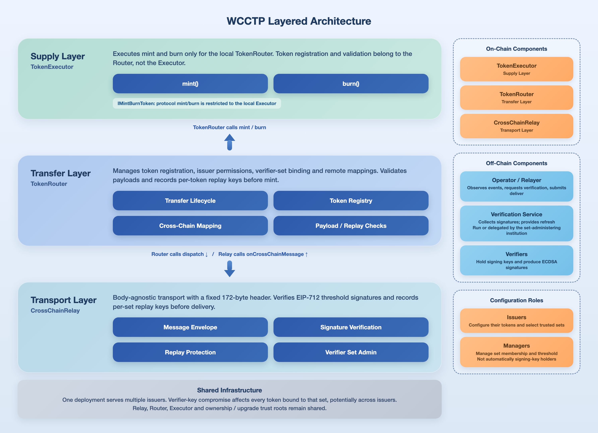
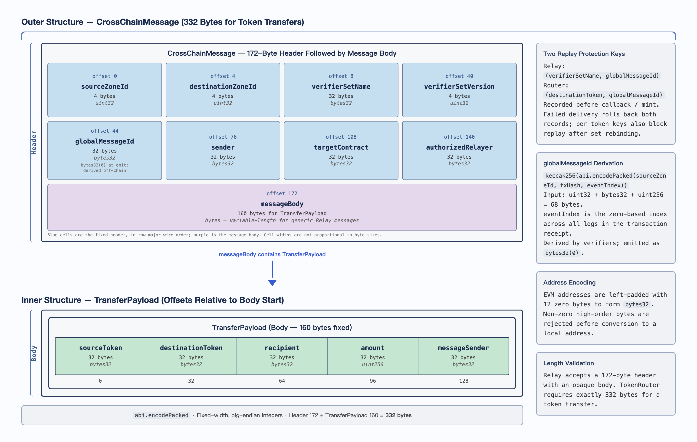
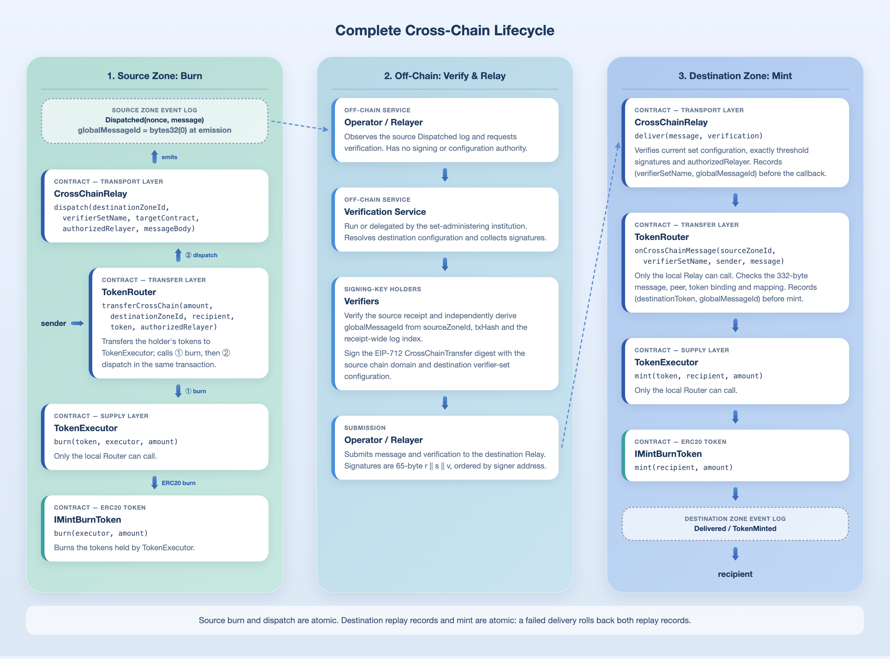

## Abstract

This proposal defines a protocol for transferring [ERC-20](./eip-20.md) tokens between Ethereum Virtual Machine (EVM) chains by burn-and-mint: tokens are destroyed on the source chain and minted on the destination chain, preserving aggregate supply without custody.

The protocol is split into three layers:

1. **Transport Layer** (`CrossChainRelay`) — message envelope, signature verification, and replay protection.
2. **Transfer Layer** (`TokenRouter`) — transfer lifecycle, multi-issuer token registry, and cross-chain mapping.
3. **Supply Layer** (`TokenExecutor`) — mint and burn on registered tokens.

The protocol hosts **multiple institutional token issuers** on one shared deployment. Each issuer binds its tokens to a verifier set, owns its mappings, and enables or disables its tokens independently. Issuers on **different** verifier sets do not share verifier-key trust; they remain reliant on the same shared Relay, Router, Executor, and any contract ownership or upgrade administration.

## Motivation

This proposal targets banks and asset issuers that issue tokens on several chains or move them across chains they already operate. One shared relay, router, and executor replaces the bespoke bridge and per-counterparty integration that every chain pair would otherwise demand. Issuers are bound by the shared modules' rules — dispatch, delivery, and verification go through the protocol contracts — yet keep full sovereignty over their own assets: verifier set, token mappings, and enablement. This proposal combines multi-issuer sovereignty with shared infrastructure. [ERC-7802](./eip-7802.md) leaves caller and verification models to implementers; [ERC-7786](./eip-7786.md) and [ERC-5164](./eip-5164.md) are generic messaging rather than token-supply protocols. Three problems remain:

1. **Lock-and-mint fragmentation.** Vault-based bridges fragment liquidity, require trust in the vault, and make exploits systemic.
2. **Verifier-key isolation within shared infrastructure.** A shared bridge with a single validator set makes one compromise reach every asset. Per-token verifier sets limit the blast radius to the tokens bound to that set, but all tokens still share the underlying Relay, Router, Executor, and contract governance keys.
3. **Monolithic contracts.** Coupling transport, transfer, and token operations makes trust boundaries hard to locate and audit.

This proposal responds by burning (no custody), per-token issuer sovereignty, per-token verifier-set bindings (blast radius = every token bound to the compromised set, potentially across issuers), and three separated layers.

## Specification

The key words "MUST", "MUST NOT", "REQUIRED", "SHALL", "SHALL NOT", "SHOULD", "SHOULD NOT", "RECOMMENDED", "NOT RECOMMENDED", "MAY", and "OPTIONAL" in this document are to be interpreted as described in RFC 2119 and RFC 8174.

### Terminology

| Term | Meaning |
| --- | --- |
| Zone | A participating chain, identified by a protocol-assigned `zoneId`. |
| Verifier | An address holding an Elliptic Curve Digital Signature Algorithm (ECDSA) key authorized to sign messages. Verifiers hold the signing keys and produce signatures. |
| Verifier set | A named group of verifiers with a signature `threshold`, a monotonic `uint32` `version`, a `configHash` that is immutable per version, and one or more administering `manager`s — a manager set whose members are equivalent, any of whom MAY administer the set. Only the relay owner registers a set, seeding its manager set with an address the administering institution supplies; those managers administer verifier membership and threshold, while the verifiers hold the signing keys. A set is not tied to any token; a token's issuer binds the token to whichever registered set it trusts through `setTokenVerifierSet`, and a set's managers need not be that token's issuers. |
| Verification | The concatenated verifier signatures accompanying a message on delivery. |
| Verification service | The off-chain service operated by or on behalf of a verifier set's administering institution that collects signatures from its verifiers and returns a verification, including forced refresh under the destination's current set. Its requirements appear in [Verification Service](#verification-service). When issuers delegate to another institution's set, that institution runs the signing service; the token's issuers remain responsible for its availability under the [Issuer Execution Guarantee](#issuer-execution-guarantee). |
| Issuer | One of the institutional entities that own and manage a registered token. A token's issuer set MAY hold several members — joint issuance by multiple institutions — and every member is equivalent: any operation this standard gates on the issuer MAY be performed by any member, and the members share the [Issuer execution guarantee](#issuer-execution-guarantee) jointly. Where the text says `Token issuer only`, the caller MUST be one of the token's issuers (see `isIssuer`). The set is seeded by `registerIssuer` and thereafter managed by its own members through `addIssuer` / `removeIssuer` / `transferIssuer`. |
| Compliance module | An optional contract (`ITransferCompliance`) an issuer registers per token through `setTokenCompliance`. When present, the router consults its `checkOutbound` before an outbound cross-chain transfer; it can only block (revert) and never mints, burns, moves tokens, or dispatches. A token with none registered (`address(0)`, the default) transfers unchanged. |
| Operator | An off-chain relayer that observes `Dispatched`, requests a verification, and submits `deliver`. This role requires no signing key and confers no contract ownership. |
| Deployment administrator | The party holding relay-owner and/or router-owner authority over deployment-wide configuration; distinct from the off-chain operator role. |
| Relay | The Transport Layer contract, `CrossChainRelay`. |
| Router | The Transfer Layer contract, `TokenRouter`. |
| Executor | The Supply Layer contract, `TokenExecutor`. |
| `CrossChainMessage` | The 332-byte wire encoding — header plus body — that is dispatched, signed over, and delivered. |
| `CrossChainTransfer` | Used for two unrelated things: the [EIP-712](./eip-712.md) struct that verifiers sign, and the `ITokenRouter` event emitted when a transfer is initiated. Text referring to the struct says "the signed struct"; text referring to the log says "the router event". |
| Deployment domain | The EIP-712 domain separator of a zone, as `bytes32`. It binds a signature to that zone's protocol name and version, [EIP-155](./eip-155.md) chain ID, and relay address. |

### Architecture Overview

The Transfer Layer depends on the Transport Layer for delivery and on the Supply Layer for supply changes. The Transport Layer and the Supply Layer MUST NOT depend on each other. Each MUST NOT hold the other's address or call into it. The Supply Layer is the protocol's token-supply executor, not Ethereum's execution-client layer.



> The architecture diagram is illustrative. The normative contract and interface names are defined in this specification.
>

### Zone Identifiers

Each participating chain is assigned a `uint32` `zoneId`, unique and immutable for the deployment lifetime. `zoneId` is independent of EIP-155 chain ID; implementations MUST NOT assume equality or derive one from the other. Every relay MUST expose `localZoneId()`.

Every relay MUST also maintain an **on-chain zone registry** mapping each `zoneId` to that zone's EIP-155 `chainId` and relay contract address, administered by the relay owner through `connectZone` and readable through `getZoneInfo`. The registry is the normative source for every field of the signed digest that is not carried in the message header (see [Verification Model](#verification-model)); `deliver` MUST rebuild the digest using registry values only and MUST NOT rely on an off-chain mapping table supplied by the caller. A zone MUST be registered before `dispatch` to it is permitted and before a message from it can be delivered; `dispatch` MUST revert for an unregistered `destinationZoneId`, and `deliver` MUST revert for an unregistered `sourceZoneId`.

The published off-chain `zoneId`-to-chain mapping SHOULD accompany the deployment for tooling, and MUST agree with the registry.

### Message Format (CrossChainMessage)

A message is a fixed-size header followed by a fixed-size body. The header carries routing and verification metadata; the body carries the `TransferPayload`.



| Field | Size | Offset | Description |
| --- | --- | --- | --- |
| `sourceZoneId` | 4 bytes | 0 | Originating zone (`uint32`) |
| `destinationZoneId` | 4 bytes | 4 | Target zone (`uint32`) |
| `verifierSetName` | 32 bytes | 8 | Verifier set whose verifiers signed the message (`bytes32`). Dispatch stamps the source binding; signing replaces it with the destination's binding. |
| `verifierSetVersion` | 4 bytes | 40 | Version of the verifier set config (`uint32`). Stamped at dispatch, replaced at signing, validated at delivery. |
| `globalMessageId` | 32 bytes | 44 | Unique message identifier (`bytes32`) |
| `sender` | 32 bytes | 76 | Sender on the source zone (`bytes32`, left-padded) |
| `targetContract` | 32 bytes | 108 | Contract that receives the message on the destination zone (`bytes32`) |
| `authorizedRelayer` | 32 bytes | 140 | Authorized caller of `deliver` (`bytes32`) |
| `messageBody` | 160 bytes | 172 | Encoded `TransferPayload` |

Fields MUST be packed without padding and in big-endian byte order, as produced by `abi.encodePacked`. The length of the header is therefore exactly 172 bytes. Implementations MUST reject any message whose length is less than 172 bytes.

The Transport Layer is body-agnostic: `deliver` requires at least the 172 header bytes and treats everything past offset 172 as an opaque body whose content is bound by `messageBodyHash`. The length of the body is fixed by the Transfer Layer instead — a `TransferPayload` is exactly 160 bytes, so a well-formed cross-chain transfer message is exactly 332 bytes, and `TokenRouter` MUST reject any other length. Trailing bytes beyond 332 therefore reach the relay but are rejected by the router, which reverts the delivery and leaves the message unconsumed.

Addresses are carried as `bytes32` so that the header keeps a fixed layout across address widths. An EVM address MUST be left-padded with twelve zero bytes, and an implementation MUST reject a `bytes32` whose high-order 12 bytes are non-zero where it is interpreted as an EVM address.

On `dispatch`, the relay MUST set `sender` to `msg.sender` (left-padded to `bytes32`) and MUST set `sourceZoneId` to `localZoneId()`. The relay MUST NOT take either field from caller-supplied data; it derives both from the execution context. This guarantees that the receiving router's check — `sender` equals the recorded peer router — authenticates the actual dispatching contract, not a value the caller chose.

`dispatch` MUST revert unless `verifierSetName` names a registered set on the local relay, and MUST stamp `verifierSetVersion` with that set's `version` at the moment of dispatch. The stamped value is informational — it records the source configuration and lets indexers and the verification service identify what was current when the burn happened — and is never the acceptance criterion: verifiers align the descriptor to the destination registry before signing (see [Off-Chain Signing and Relay Orchestration](#off-chain-signing-and-relay-orchestration)), and the destination validates against its own registry ([Verification Model](#verification-model)).

Wherever a `bytes32` field is interpreted as an EVM address — including `sender`, `targetContract`, `authorizedRelayer` in the header, and `sourceToken`, `destinationToken`, `recipient`, `messageSender` in the payload — the implementation MUST validate that the high-order 12 bytes are zero before converting to `address`. A `bytes32` with non-zero high-order bytes MUST be rejected at the entry point that reads it, not silently truncated.

#### `globalMessageId`

Identifies a message uniquely across zones and verifier sets; the replay-protection key. Derived as:

```plain
globalMessageId = keccak256(abi.encodePacked(sourceZoneId, txHash, eventIndex))
```

where:

- `txHash` is the hash of the source-chain transaction that called `dispatch`, as `bytes32`.
- `eventIndex` is the zero-based index of the `Dispatched` event log within the full list of logs in that transaction's receipt — counted across every log the transaction emits, not only `Dispatched` logs — encoded as a `uint256`. The verifier MUST confirm that the log at this index is the expected `Dispatched` event before deriving `globalMessageId`.

Because `abi.encodePacked` emits each operand at its declared width, the three operands are fixed: `sourceZoneId` is `uint32` (4 bytes), `txHash` is `bytes32` (32 bytes), and `eventIndex` is `uint256` (32 bytes), giving a 68-byte packed input. An implementation that widens or narrows any operand derives a different `globalMessageId` for the same event, which breaks replay protection and makes the verifiers' reconstruction disagree with the destination's acceptance check. Every implementation MUST reproduce the shared vectors in [Test Cases](#test-cases). Every deployment MUST additionally publish a cross-language test vector for this derivation — the three inputs and the resulting `globalMessageId` — alongside its reference implementation.

Uniqueness follows because `txHash` is unique within a chain, `sourceZoneId` disambiguates across chains, and `eventIndex` disambiguates multiple dispatches within a single transaction.

The relay MUST set `globalMessageId` to `bytes32(0)` in the `message` bytes emitted in the `Dispatched` event. Each verifier MUST derive `globalMessageId` independently from the source-chain transaction receipt and substitute it into the message header, and MUST verify that every other header field still matches the `Dispatched` event log, except the `verifierSetName`/`verifierSetVersion` descriptor, which the verifier replaces with the destination's current binding. A verifier MUST NOT sign if any field outside those three slots differs from the emitted log. The single permitted body difference is the token-address rewrite a verifier itself re-derives from on-chain state for an in-flight message during a token address migration, defined in [Token address migration is drain-and-swap](#token-address-migration-is-drain-and-swap): it changes only the body's `sourceToken`/`destinationToken` field, leaves `globalMessageId` and the whole header untouched, and MUST be signed under the same `verifierSetName`.

#### `authorizedRelayer`

If `bytes32(0)`, any address MAY call `deliver`. Otherwise the relay MUST reject a caller other than `authorizedRelayer`. It restricts who submits, not who receives tokens.

### Delivery Validation

On `deliver`, the relay MUST perform the following checks and MUST revert if any fails:

1. `message.length` is at least 172 bytes, so every fixed-offset header field is present.
2. `destinationZoneId` equals `localZoneId()`.
3. `authorizedRelayer` is `bytes32(0)` or equals `msg.sender`.
4. `verifierSetName` names a registered verifier set.
5. `sourceZoneId` has an entry in the local zone registry; the entry supplies the `chainId` and relay address required to rebuild the signed digest. A message from an unregistered zone MUST NOT be verified against any off-chain mapping table.
6. The verification satisfies the rules in [Verification Model](#verification-model).
7. The pair `(verifierSetName, globalMessageId)` has not been consumed.
8. `targetContract` points to an address with non-zero code length. A relay MUST NOT deliver a message to an address without deployed contract code, since the `onCrossChainMessage` call would succeed vacuously and the message would be permanently consumed with no effect.

The relay MUST record `(verifierSetName, globalMessageId)` as consumed **before** invoking the target contract, so that a reentrant call cannot process the same message twice. It MUST then invoke `onCrossChainMessage` on `targetContract`, passing the `sourceZoneId`, `verifierSetName`, and `sender` decoded from the header together with the **full `message` bytes, as verified — including the substituted `globalMessageId` and the descriptor the verifiers signed** — so that the receiver can validate the fields the relay does not decode for it, notably `verifierSetVersion`. The relay MUST propagate a revert from that call, and MUST emit `Delivered` only on success; because the consumption record is written in the same transaction, a reverted delivery leaves the message replayable.

### TransferPayload Format

The `TransferPayload` is the body carried inside a `CrossChainMessage`.

| Field | Size | Offset | Description |
| --- | --- | --- | --- |
| `sourceToken` | 32 bytes | 0 | Token destroyed on the source zone (`bytes32`) |
| `destinationToken` | 32 bytes | 32 | Token to mint on the destination zone (`bytes32`) |
| `recipient` | 32 bytes | 64 | Recipient of the minted tokens (`bytes32`) |
| `amount` | 32 bytes | 96 | Amount, in the token's smallest unit (`uint256`) |
| `messageSender` | 32 bytes | 128 | Address that initiated the transfer (`bytes32`) |

The fixed part of the payload is exactly 160 bytes. Implementations MUST reject a payload whose length is not exactly 160 bytes.

`messageSender` is set by the router to the address that called `transferCrossChain` (left-padded to `bytes32`). It is carried for informational and audit purposes; receiving implementations MAY use it for rate limiting, compliance, or event logging.

### Token Compatibility

A participating token MUST implement [ERC-20](./eip-20.md), `IMintBurnToken`, and `decimals()`. Mapped tokens MUST report the same `decimals()`.

`amount` is carried verbatim; the Transfer Layer MUST NOT rescale it. Issuers MUST confirm decimals match before `mapToken`.

Fee-on-transfer, rebasing, and other tokens where the delivered amount differs from the transferred amount are incompatible. Issuers MUST NOT map such tokens, or MUST use a wrapper that guarantees lossless transfers.

### Interface: ICrossChainRelay (Transport Layer)

```solidity
interface ICrossChainRelay {
    /// @notice Emitted when a message is dispatched. `globalMessageId` inside
    ///         `message` is bytes32(0); verifiers derive and substitute it.
    event Dispatched(uint64 indexed nonce, bytes message);

    /// @notice Emitted when a verified message is delivered to its target.
    ///         `messageBody` duplicates data already visible in the source chain's
    ///         `Dispatched` event and costs destination gas; it is included so that
    ///         indexers can settle a delivery from destination logs alone.
    event Delivered(
        address indexed caller,
        bytes32 indexed globalMessageId,
        uint32 sourceZoneId,
        bytes32 sender,
        bytes messageBody
    );

    /// @notice Dispatches a cross-chain message.
    /// @param destinationZoneId Target zone.
    /// @param verifierSetName Verifier set bound to the token on this zone. It is
    ///        stamped into the header for indexing; the set that actually signs is
    ///        the one bound to the destination token on the destination zone.
    /// @param targetContract Destination contract (bytes32).
    /// @param authorizedRelayer Authorized caller of `deliver` (bytes32(0) = anyone).
    /// @param messageBody Encoded TransferPayload.
    /// @return nonce Relay-local sequence number.
    function dispatch(
        uint32 destinationZoneId,
        bytes32 verifierSetName,
        bytes32 targetContract,
        bytes32 authorizedRelayer,
        bytes calldata messageBody
    ) external returns (uint64 nonce);

    /// @notice Verifies and delivers a message to its target contract.
    /// @param message Full encoded CrossChainMessage.
    /// @param verification Concatenated 65-byte ECDSA signatures.
    function deliver(bytes calldata message, bytes calldata verification) external;

    /// @notice Returns true if a message has been consumed in this verifier set name.
    function isConsumed(bytes32 verifierSetName, bytes32 globalMessageId) external view returns (bool);

    /// @notice Returns the zone identifier of this deployment.
    function localZoneId() external view returns (uint32);

    /// @notice Returns the EIP-712 domain separator of the LOCAL zone, i.e. the
    ///         value used when this relay is the source of a message. Verifying an
    ///         inbound message requires the SOURCE zone's separator, which this
    ///         function is NOT: rebuild it from getZoneInfo(sourceZoneId).
    function deploymentDomain() external view returns (bytes32);

    // ── Zone Registry ────────────────────────────────────────────────

    event ZoneConnected(uint32 indexed zoneId, uint256 chainId, bytes32 relay);

    /// @notice Records or updates a zone's EIP-155 chainId and relay address.
    ///         Relay-owner only. MUST be set before dispatch to `zoneId` is
    ///         permitted and before a message from `zoneId` can be delivered.
    ///         SHOULD be timelocked: an incorrect entry silently breaks
    ///         digest reconstruction for every message from that zone.
    function connectZone(uint32 zoneId, uint256 chainId, bytes32 relay) external;

    /// @notice Returns the registered chainId and relay address for a zone.
    ///         MUST revert if `zoneId` is not registered.
    function getZoneInfo(uint32 zoneId) external view returns (uint256 chainId, bytes32 relay);

    // ── Verifier Set Administration ──────────────────────────────────

    event VerifierSetRegistered(bytes32 indexed setName, address indexed manager, uint32 version, bytes32 configHash);
    event ManagerAdded(bytes32 indexed setName, address indexed manager);
    event ManagerRemoved(bytes32 indexed setName, address indexed manager);
    event VerifierAdded(bytes32 indexed setName, address indexed verifier, uint32 newVersion, bytes32 newConfigHash);
    event VerifierRemoved(bytes32 indexed setName, address indexed verifier, uint32 newVersion, bytes32 newConfigHash);
    event ThresholdChanged(bytes32 indexed setName, uint256 newThreshold, uint32 newVersion, bytes32 newConfigHash);
    /// @dev Emitted when the new manager calls `acceptVerifierSetManager`.
    event VerifierSetManagerTransferred(
        bytes32 indexed setName,
        address indexed previousManager,
        address indexed newManager
    );

    /// @notice Registers a verifier set. Relay-owner only, create-only. The relay
    ///         owner registers the set on behalf of the institution that will
    ///         administer it and seeds its manager set with the `manager` address
    ///         that institution supplies — an address the institution chooses, not
    ///         necessarily one of any token's issuers. A set MAY later hold several
    ///         equivalent managers through `addManager`. The managers administer the
    ///         set; its verifiers hold the signing keys and produce signatures.
    ///         A set is not tied to any token — a token's issuer binds it through
    ///         `setTokenVerifierSet`, and the set's managers need not be that token's
    ///         issuers.
    ///         Initializes `version` to 1 with no verifiers and `threshold` 0;
    ///         such a set verifies nothing until its managers populate it.
    ///         MUST revert if `setName` is already registered on this relay:
    ///         re-registering would reset `version`, membership and the manager set,
    ///         breaking version monotonicity and stranding every token bound to the
    ///         set. Because a single relay cannot see the other zones, the relay owner
    ///         MUST also ensure `setName` is not already registered on any chain where
    ///         the protocol is deployed, so one name denotes one set across every zone
    ///         and a name cannot be squatted on a chain its original registrant has
    ///         not yet reached; the contract enforces only local uniqueness, while
    ///         global uniqueness is the relay owner's operational duty.
    ///         Later changes go through the manager-gated `addVerifier` /
    ///         `removeVerifier` / `setThreshold`, each of which bumps `version`.
    function registerVerifierSet(bytes32 setName, address manager) external;

    /// @notice Adds a manager to a verifier set's manager set. Caller MUST be one
    ///         of the set's current managers. Emits `ManagerAdded`. MUST revert if
    ///         `manager` is the zero address or is already in the set.
    function addManager(bytes32 setName, address manager) external;

    /// @notice Removes a manager's own seat from a verifier set's manager set.
    ///         Caller MUST equal `manager` — a manager MAY only remove itself, never
    ///         another, mirroring `removeIssuer`. Emits `ManagerRemoved`. MUST revert
    ///         if `manager` is not in the set, or if it is the last remaining
    ///         manager, so a set is never left unadministered.
    function removeManager(bytes32 setName, address manager) external;

    /// @notice Adds a verifier. Caller MUST be one of the set's managers.
    ///         Reverts on the zero address or an existing member.
    function addVerifier(bytes32 setName, address verifier) external;

    /// @notice Removes a verifier. Caller MUST be one of the set's managers.
    ///         Reverts if the address is not a member, or if the remaining
    ///         count would fall below `threshold`.
    function removeVerifier(bytes32 setName, address verifier) external;

    /// @notice Changes the signature threshold. Caller MUST be one of the set's
    ///         managers. `newThreshold` MUST be > 0 and ≤ verifier count.
    function setThreshold(bytes32 setName, uint256 newThreshold) external;

    /// @notice Nominates a replacement for the caller's own seat in a set's
    ///         manager set. Caller MUST be one of the set's current managers; the
    ///         transfer replaces only the caller's seat and leaves every other
    ///         manager untouched. Completes when `newManager` calls
    ///         `acceptVerifierSetManager`. Emits `VerifierSetManagerTransferred`.
    function transferVerifierSetManager(bytes32 setName, address newManager) external;

    /// @notice Accepts a nomination, taking over the nominating manager's seat.
    ///         Caller MUST be the nominated `newManager`; on acceptance the
    ///         nominator leaves the set and the caller joins it.
    function acceptVerifierSetManager(bytes32 setName) external;

    // ── Verifier Set Views ───────────────────────────────────────────

    /// @notice The core configuration of a set. The manager set is not returned
    ///         here — a set MAY have several managers, so it is read through
    ///         `getManagers` / `isManager` below.
    function getVerifierSetInfo(bytes32 setName)
        external
        view
        returns (uint256 threshold, uint256 verifierCount, uint32 version, bytes32 configHash);

    /// @notice The full manager set recorded for a verifier set; an empty array if
    ///         the set is not registered.
    function getManagers(bytes32 setName) external view returns (address[] memory managers);

    /// @notice Whether `candidate` is one of a set's managers — the authority check
    ///         behind every manager-gated administration call.
    function isManager(bytes32 setName, address candidate) external view returns (bool);

    function getVerifierAtIndex(bytes32 setName, uint256 index)
        external
        view
        returns (address);

    /// @notice Returns the `configHash` recorded for a historical version of a set.
    ///         SHOULD be supported for every version that was ever active, so that
    ///         delivered messages can be audited and reconciled against the
    ///         configuration they were signed under.
    function getConfigHashAtVersion(bytes32 setName, uint32 version) external view returns (bytes32 configHash);
}
```

`nonce` is a relay-local strictly increasing counter for transaction correlation. It is not in the header and MUST NOT be used for replay protection.

### Interface: ITokenRouter (Transfer Layer)

```solidity
interface ITokenRouter {
    /// @notice Emitted when the router initiates a cross-chain transfer, i.e. after
    ///         the source burn and the corresponding `dispatch`. Distinct from the
    ///         `CrossChainTransfer` struct that verifiers sign.
    event CrossChainTransfer(
        uint64 indexed nonce,
        address indexed token,
        uint256 amount,
        address indexed sender,
        bytes32 recipient,
        uint32 destinationZoneId
    );

    event TokenMinted(address indexed token, address indexed recipient, uint256 amount);

    event IssuerRegistered(address indexed token, address indexed issuer);

    event IssuerAdded(address indexed token, address indexed issuer);

    event IssuerRemoved(address indexed token, address indexed issuer);

    event TokenVerifierSetChanged(address indexed token, bytes32 verifierSetName);

    event TokenMapped(
        address indexed localToken,
        uint32 indexed remoteZoneId,
        bytes32 remoteToken
    );

    event TokenRemapped(
        address indexed oldLocalToken,
        address indexed newLocalToken,
        uint32 indexed remoteZoneId,
        bytes32 remoteToken
    );

    event PeerConnected(uint32 indexed zoneId, bytes32 peerRouter);

    event TokenOutboundEnabledSet(address indexed token, uint32 indexed zoneId, bool enabled);

    event TokenInboundEnabledSet(address indexed token, bool enabled);

    event TokenComplianceSet(address indexed token, address indexed complianceModule);

    event IssuerTransferInitiated(
        address indexed token,
        address indexed currentIssuer,
        address indexed newIssuer
    );

    event IssuerTransferred(
        address indexed token,
        address indexed previousIssuer,
        address indexed newIssuer
    );

    /// @notice Burns tokens on source and dispatches a cross-chain transfer.
    /// @param amount Amount to transfer; MUST be non-zero.
    /// @param destinationZoneId Target zone.
    /// @param recipient Recipient on destination (bytes32); MUST be non-zero.
    /// @param token Token to burn on this zone.
    /// @param authorizedRelayer Authorized caller of `deliver` (bytes32(0) = anyone).
    /// @return nonce Relay-assigned nonce.
    function transferCrossChain(
        uint256 amount,
        uint32 destinationZoneId,
        bytes32 recipient,
        address token,
        bytes32 authorizedRelayer
    ) external returns (uint64 nonce);

    /// @notice Registers the initial issuer for a token. Router-owner only, once
    ///         per token — it seeds the issuer set, after which the set is managed
    ///         by its own members through `addIssuer` / `removeIssuer` /
    ///         `transferIssuer`. A token MAY have several issuers (joint issuance by
    ///         multiple institutions); every member is equivalent and MAY perform any
    ///         operation this standard gates on "Token issuer only".
    function registerIssuer(address token, address issuer) external;

    /// @notice Adds an issuer to a token's issuer set. Caller MUST be one of the
    ///         token's current issuers. Emits `IssuerAdded`. MUST revert if `issuer`
    ///         is the zero address or is already in the set, so membership is never
    ///         silently duplicated.
    function addIssuer(address token, address issuer) external;

    /// @notice Removes an issuer's own seat from a token's issuer set. Caller MUST
    ///         equal `issuer` — a member MAY only remove itself, never another, so no
    ///         issuer can unilaterally strip the others' authority. Emits
    ///         `IssuerRemoved`. MUST revert if `issuer` is not in the set, or if it is
    ///         the last remaining issuer, so a token is never left without an
    ///         authority over its configuration.
    function removeIssuer(address token, address issuer) external;

    /// @notice Binds a token to a verifier set. Token issuer only.
    ///         MUST revert unless `verifierSetName` names a set registered on the
    ///         local relay: a binding to an unknown set makes every inbound message
    ///         for the token undeliverable, with the tokens already burned upstream.
    function setTokenVerifierSet(address token, bytes32 verifierSetName) external;

    /// @notice Maps a local token to its remote counterpart for a given zone.
    ///         Token issuer only. MUST revert on a zero `remoteToken`, so a mapping
    ///         is never cleared by accident; retiring one is a separate, deliberate
    ///         act through `remapToken`. Overwrites any existing mapping for the same
    ///         `localToken` and `remoteZoneId`.
    function mapToken(address localToken, uint32 remoteZoneId, bytes32 remoteToken)
        external;

    /// @notice Atomically migrates a token's mapping for one zone from an old local
    ///         address to a new one: sets `(newLocalToken, remoteZoneId)` to
    ///         `remoteToken`, resets `(oldLocalToken, remoteZoneId)` to zero in the
    ///         same call, and emits `TokenRemapped`. Token issuer only — the caller
    ///         MUST be one of the issuers recorded for `oldLocalToken`, and
    ///         `newLocalToken` comes under the same issuer set. MUST revert on a zero
    ///         `remoteToken`, when
    ///         `oldLocalToken` equals `newLocalToken`, or when `oldLocalToken` holds no
    ///         mapping for `remoteZoneId` to retire, so the call is never a silent
    ///         no-op and the event always carries a real previous binding. A token
    ///         address migration MUST call this only after the normally-deliverable
    ///         in-flight messages for `oldLocalToken` have drained (see [Token address
    ///         migration is drain-and-swap](#token-address-migration-is-drain-and-swap)):
    ///         retiring the old address while such a message is still pending strands it,
    ///         because the stale `destinationToken` stops resolving and receiving check 7
    ///         rejects it. Residuals that cannot drain, for example because the old
    ///         token rejects minting, require the restricted verifier-derived rewrite
    ///         to `newLocalToken` and remain the issuers' responsibility if unresolved.
    ///         Once retired, a
    ///         pre-migration message naming `oldLocalToken` can no longer be delivered,
    ///         which closes the replay window the rewrite otherwise leaves behind.
    function remapToken(
        address oldLocalToken,
        address newLocalToken,
        uint32 remoteZoneId,
        bytes32 remoteToken
    ) external;

    /// @notice Records peer TokenRouter addresses per zone. Router-owner only.
    ///         One-time per zone: MUST revert if any listed zone already has a
    ///         non-zero peer. Overwriting a live peer silently disconnects every
    ///         token that routes through that zone, on the outbound path
    ///         (`targetContract`) and the inbound path (the peer check) at once.
    ///         Replacements go through `proposePeerUpdate` / `applyPeerUpdate`.
    function connectPeer(uint32[] calldata zoneIds, bytes32[] calldata peerRouters)
        external;

    event PeerUpdateProposed(
        uint32 indexed zoneId,
        bytes32 currentPeer,
        bytes32 proposedPeer,
        uint64 executableAt
    );

    event PeerUpdated(uint32 indexed zoneId, bytes32 previousPeer, bytes32 newPeer);

    /// @notice Queue a replacement peer router for a zone. Router-owner only.
    ///         `executableAt` MUST be at least `PEER_UPDATE_DELAY` seconds ahead.
    ///         A peer that is merely proposed has no effect on validation yet, so
    ///         issuers and relayers can read `getPendingPeerUpdate` and object
    ///         before traffic is silently redirected.
    function proposePeerUpdate(uint32 zoneId, bytes32 newPeerRouter) external;

    /// @notice Apply the queued peer update. Router-owner only.
    ///         MUST revert if nothing is proposed for the zone or the delay has not
    ///         elapsed. The previous peer stays authoritative until this call
    ///         succeeds; a re-proposal replaces the pending value and restarts the
    ///         delay.
    function applyPeerUpdate(uint32 zoneId) external;

    /// @notice Enables or disables outbound transfers for a token toward a single
    ///         destination zone. Token issuer only. Per-path granularity lets an
    ///         issuer pause one route — e.g. toward a chain mid-migration — while
    ///         leaving the token's other destinations open; disabling every route
    ///         means calling this once per connected zone.
    function setTokenOutboundEnabled(address token, uint32 zoneId, bool enabled) external;

    /// @notice Enables or disables inbound minting for a token, from every source
    ///         zone. Token issuer only. Inbound stays per-token: draining in-flight
    ///         messages during a migration requires the destination to keep minting,
    ///         so inbound is deliberately not gated per source zone.
    function setTokenInboundEnabled(address token, bool enabled) external;

    /// @notice Sets the compliance module consulted before a token's outbound
    ///         cross-chain transfers. Token issuer only (any of the token's
    ///         issuers). Optional: the zero address — the default — means no
    ///         module, and the token transfers exactly as if this function had
    ///         never been called. When a non-zero module is registered,
    ///         `transferCrossChain` MUST call its `checkOutbound` before moving
    ///         any token and MUST revert if that call reverts. Re-registering
    ///         overwrites the previous module; setting it back to the zero
    ///         address disables the check. Emits `TokenComplianceSet`.
    function setTokenCompliance(address token, address complianceModule) external;

    /// @notice Nominates a replacement for the caller's own seat in a token's
    ///         issuer set. Caller MUST be one of the token's current issuers; the
    ///         transfer replaces only the caller's seat and leaves every other issuer
    ///         untouched. Completes when `newIssuer` calls `acceptIssuer`. Emits
    ///         `IssuerTransferInitiated`.
    function transferIssuer(address token, address newIssuer) external;

    /// @notice Accepts a nomination, taking over the nominating issuer's seat.
    ///         Caller MUST be the nominated `newIssuer`; on acceptance the nominator
    ///         leaves the set and the caller joins it. Emits `IssuerTransferred`.
    function acceptIssuer(address token) external;

    // ── Configuration Views ──────────────────────────────────────────

    /// @notice The full issuer set recorded for a token; an empty array if the
    ///         token is not registered in the protocol.
    function getIssuers(address token) external view returns (address[] memory issuers);

    /// @notice Whether `candidate` is one of the token's issuers — the authority
    ///         check behind every "Token issuer only" operation.
    function isIssuer(address token, address candidate) external view returns (bool);

    /// @notice Verifier set currently bound to a token; bytes32(0) if none is
    ///         bound. Inbound delivery for an unbound token always reverts.
    function getVerifierSet(address token) external view returns (bytes32 verifierSetName);

    /// @notice Remote token mapped from `localToken` for `remoteZoneId`;
    ///         bytes32(0) if no mapping exists.
    function getMappedToken(address localToken, uint32 remoteZoneId)
        external
        view
        returns (bytes32 remoteToken);

    /// @notice Peer router recorded for a zone; bytes32(0) if none.
    function getPeerRouter(uint32 zoneId) external view returns (bytes32 peerRouter);

    /// @notice Peer router proposed for a zone and the earliest timestamp at which
    ///         it may be applied. (bytes32(0), 0) when no update is pending.
    function getPendingPeerUpdate(uint32 zoneId)
        external
        view
        returns (bytes32 proposedPeerRouter, uint64 executableAt);

    /// @notice Whether outbound transfers are enabled for a token toward `zoneId`.
    function isOutboundEnabled(address token, uint32 zoneId) external view returns (bool);

    /// @notice Whether inbound mints are enabled for a token.
    function isInboundEnabled(address token) external view returns (bool);

    /// @notice The compliance module consulted before a token's outbound
    ///         transfers; `address(0)` if none is registered, the default. When
    ///         non-zero, `transferCrossChain` calls its `checkOutbound` before
    ///         any token moves and reverts if that reverts.
    function getTokenCompliance(address token) external view returns (address complianceModule);

    /// @notice Whether `(destinationToken, globalMessageId)` has already been
    ///         delivered (minted) through this router. The off-chain refresh
    ///         endpoint reads this to treat a message settled under any prior
    ///         verifier-set binding as already-settled rather than re-signing it.
    function isMessageDelivered(address destinationToken, bytes32 globalMessageId)
        external
        view
        returns (bool delivered);
}
```

Every view function under `Configuration Views` in `ITokenRouter` MUST be callable by anyone; the state-changing functions retain their specified access controls. They exist so that an issuer can establish the state of its own token without trusting an off-chain index, and so that a relayer can decide whether a message is deliverable before spending gas: the binding in `getVerifierSet`, the mapping in `getMappedToken`, the authority chain in `getIssuers` / `getPeerRouter`, the enablement flags, the optional compliance module in `getTokenCompliance`, and the delivery record in `isMessageDelivered` together are the inputs to the initiating and receiving checks, and none of them is otherwise readable on-chain. Deployments that hold tokens across several zones SHOULD additionally expose an aggregate read that walks every peer zone in one call.

`PEER_UPDATE_DELAY` MUST be a positive duration fixed at deployment and SHOULD be at least 24 hours — long enough for an issuer monitoring `getPendingPeerUpdate` to disable inbound for its tokens before a misdirected peer becomes authoritative. An update applied in error is undone by the same two-step path, so no peer change is ever instantaneous.

#### Initiating a Transfer

On `transferCrossChain`, the router MUST verify that:

1. `token` is registered and outbound-enabled toward `destinationZoneId`.
2. A verifier set is bound to `token`.
3. A mapping exists from `token` to a non-zero `destinationToken` for `destinationZoneId`.
4. A non-zero peer router is recorded for `destinationZoneId`.
5. `amount` and `recipient` are non-zero.
6. If `getTokenCompliance(token)` is non-zero, the registered module's `checkOutbound(token, caller, amount, destinationZoneId, recipient)` returns without reverting — a revert blocks the transfer.

If a compliance module is registered for `token`, the router MUST call its `checkOutbound` before moving any token and MUST revert if that call reverts (see [ITransferCompliance](#interface-itransfercompliance-transfer-layer)), so a blocked transfer burns nothing and dispatches nothing. It MUST then transfer `amount` from the caller to the Supply Layer, MUST require that transfer to report success — a falsy return from an ERC-20 `transfer` is a failure and MUST revert the whole call — MUST call `burn(token, executor, amount)` so that the source supply falls from the balance the executor just received, and only then MUST dispatch the message with `targetContract` set to the recorded peer router for `destinationZoneId` and `verifierSetName` set to the verifier set bound to `token`. Because `burn` takes a `from` address chosen by the router, the router's caller model is the only thing standing between a transfer and a burn of someone else's balance: `from` MUST be the Supply Layer address that the preceding `transfer` funded, and MUST NOT be taken from the function arguments.

#### Receiving a Transfer

On `onCrossChainMessage`, the router MUST decode the `sourceZoneId`, `destinationZoneId`, `verifierSetName`, `verifierSetVersion`, `globalMessageId`, `sender`, `targetContract`, `authorizedRelayer`, and `messageBody` from the `message` bytes rather than trusting the separately supplied arguments, and MUST verify that:

1. `msg.sender` is the local relay.
2. The separately supplied `sourceZoneId`, `verifierSetName`, and `sender` equal the values decoded from `message`; a mismatch MUST revert.
3. `sender` equals the peer router recorded for `sourceZoneId`, and that peer is non-zero.
4. `message` is exactly 332 bytes — a 172-byte header followed by a `messageBody` of exactly 160 bytes.
5. `destinationToken` resolves to a token that is registered locally and inbound-enabled.
6. `verifierSetName` equals the set currently bound to `destinationToken`, and `verifierSetVersion` equals the current `version` of that set on the local relay.
7. The mapping for `destinationToken` on `sourceZoneId` equals `sourceToken`.
8. `recipient` and `amount` are non-zero.
9. `targetContract` equals the local router's own address; a message addressed to another contract MUST NOT be minted through this router.
10. `(destinationToken, globalMessageId)` has not already been recorded as delivered by this router.

Check 6 enforces per-token verifier set isolation. Check 3 prevents arbitrary accounts from dispatching forged payloads through the shared relay. Check 2 exists because the relay decodes those arguments on the receiver's behalf: the signed message, not its decoded shadow, is the authoritative input.

The router MUST record `(destinationToken, globalMessageId)` as delivered **before** it invokes the Supply Layer's `mint`, in the same transaction, so that a reverted delivery leaves the message replayable — mirroring the relay's record-before-invoke rule in [Delivery Validation](#delivery-validation). Check 10 is what makes delivery idempotent across a verifier-set re-binding: the relay's `(verifierSetName, globalMessageId)` key is per-set, so a message delivered under set `A` leaves `(B, globalMessageId)` free once the token is rebound to `B`, and a refresh resolving `B` could otherwise collect fresh signatures and mint a second time. The router key is keyed on the token, not the set, so it survives the `A`→`B` move and the second delivery reverts at check 10 before any mint. Because `globalMessageId` is 1:1 with a dispatch — hence with a single `destinationToken` — recording it for one issuer's token cannot consume another issuer's slot, so the cross-set isolation the relay key provides is preserved.

### Interface: ITransferCompliance (Transfer Layer)

An issuer MAY gate its token's outbound cross-chain transfers on a compliance
check — a know-your-customer/anti-money-laundering (KYC/AML) clearance of the holder, or a policy keyed on the destination
zone and the recipient. This hook is reserved at the standard level and is
optional: a token with no module registered (`getTokenCompliance` returns
`address(0)`, the default) transfers exactly as if this interface did not exist.

```solidity
interface ITransferCompliance {
    /// @notice Consulted by the local TokenRouter during `transferCrossChain`,
    ///         after the initiating checks and before any token moves. A normal
    ///         return clears the transfer; the module MUST revert to block a
    ///         non-compliant one. Carries the full outbound context so policy can
    ///         key on the destination zone and recipient — which a token-level
    ///         transfer restriction, seeing only `(from, executor, amount)`,
    ///         cannot. Read-only with respect to the protocol: it MUST NOT change
    ///         any token's supply and MUST NOT call back into the router.
    function checkOutbound(
        address token,
        address from,               // the holder initiating the transfer
        uint256 amount,
        uint32 destinationZoneId,
        bytes32 recipient
    ) external view;
}
```

The router calls `checkOutbound` only when a module is registered for `token`,
passes the initiating holder as `from` (never an argument-supplied address), and
treats any revert as a block that reverts the whole `transferCrossChain`.
Because the call precedes the token transfer and the burn, a blocked transfer
moves nothing, burns nothing, and dispatches nothing, so the Supply Conservation
invariant is untouched. The module is issuer-controlled and trusted by the
issuer alone; the protocol neither vets nor endorses its logic (see
[Outbound compliance hook](#outbound-compliance-hook)).

This revision reserves the outbound direction only. An inbound (recipient-side)
compliance gate is deliberately left to a future revision: enforcing it on the
destination without stranding already-burned tokens requires hold-not-revert
semantics that this version does not define.

### Interface: ITokenExecutor (Supply Layer)

```solidity
interface ITokenExecutor {
    event Minted(address indexed token, address indexed to, uint256 amount);
    event Burned(address indexed token, address indexed from, uint256 amount);

    /// @notice Mints tokens to a recipient.
    ///         Callable only by the local TokenRouter.
    function mint(address token, address to, uint256 amount) external;

    /// @notice Burns tokens held by `from`.
    ///         Callable only by the local TokenRouter.
    function burn(address token, address from, uint256 amount) external;
}
```

The Supply Layer holds exclusive mint/burn rights. It MUST reject calls from any address other than the local router. Token validation (registration, enabled state, mapping) is the Router's responsibility; the executor trusts the router's judgment and does not maintain an independent token registry.

### Interface: IMintBurnToken

A participating token MUST implement ERC-20 and MUST additionally implement `IMintBurnToken`:

```solidity
interface IMintBurnToken {
    /// @notice Mints `amount` tokens to `to`.
    function mint(address to, uint256 amount) external;

    /// @notice Burns `amount` tokens from `from`.
    function burn(address from, uint256 amount) external;
}
```

A token MUST grant `mint` and `burn` to the local `TokenExecutor` so the cross-chain path (router → executor → token) can settle. The executor is not required to be the token's only minter: an issuer MAY grant minter or burner rights to additional addresses it controls and issue or redeem locally through them. Supply moved by those additional minters or burners is outside the cross-chain flow and MUST be accounted for in the off-chain `issuedLocally` / `redeemedLocally` totals defined in [Supply Conservation Invariant](#supply-conservation-invariant). These are accounting terms, not functions or events; no new reporting interface is defined. Only the executor's router-instructed `mint` is attributable to a delivered message, and a conforming router MUST NOT instruct an executor mint without a successful delivery.

Tokens that implement [ERC-7802](./eip-7802.md) `crosschainMint`/`crosschainBurn` are functionally equivalent. An executor MAY call `crosschainMint`/`crosschainBurn` instead of `mint`/`burn` for such tokens, provided the caller is restricted to the local `TokenExecutor` and the supply semantics remain identical.

### Interface: ICrossChainReceiver

A contract that receives cross-chain messages MUST implement:

```solidity
interface ICrossChainReceiver {
    /// @notice Invoked by the local relay when a verified message is delivered.
    /// @param sourceZoneId The originating zone, decoded from `message`.
    /// @param verifierSetName The verifier set that verified the message, decoded from `message`.
    /// @param sender The sender on the source zone (bytes32), decoded from `message`.
    /// @param message The full encoded CrossChainMessage — 172-byte header plus body —
    ///        with the derived `globalMessageId` substituted into the header.
    function onCrossChainMessage(
        uint32 sourceZoneId,
        bytes32 verifierSetName,
        bytes32 sender,
        bytes calldata message
    ) external;
}
```

The first three arguments are conveniences decoded by the relay from `message`; they add no assurance that the receiver could not obtain itself, and a receiver that needs header fields the relay does not decode — `verifierSetVersion` above all — MUST parse `message`. A receiver MUST therefore treat `message` as the authoritative input and MUST revert if a supplied argument disagrees with the decoded value.

Implementations MUST reject calls from any address other than the local relay, and MUST revert on a malformed message so the relay does not record an unprocessed message. `verifierSetName` is passed through because the receiver, not the relay, knows the acceptable set for a given asset.

### Verification Model

Each verifier set has a unique `setName` (`bytes32`), a `threshold` (`uint256`), a monotonic `version` (`uint32`), an immutable `configHash` per version, verifier addresses, and one or more `manager`s seeded at registration by the relay owner from an address the administering institution supplies — not necessarily the issuers of any token bound to it. The `configHash` for a given version is:

```solidity
configHash = keccak256(abi.encode(
    setName,                                     // bytes32
    version,                                     // uint32
    threshold,                                   // uint256
    verifierAddressesSortedAscending             // address[]
));
```

`verifierAddressesSortedAscending` is the array of current members of the verifier set, sorted in strictly ascending order. Membership changes only through `addVerifier` and `removeVerifier`; no separate enabled/disabled verifier state is defined. The four arguments MUST be encoded with exactly the Solidity types above. Note that `abi.encode` head-pads every integer to a 32-byte word, so `version` declared `uint32` and the same value widened to `uint256` produce identical `configHash` bytes — the width is not what this hash commits to. The declared width is normative elsewhere: in the EIP-712 struct, `CrossChainTransfer.verifierSetVersion` MUST stay `uint32`, because the typehash commits to the declared type string and redeclaring it as `uint256` changes `CROSS_CHAIN_TRANSFER_TYPEHASH`, hence the digest, so signatures gathered under one declaration fail under the other; and in any `abi.encodePacked` use, where `uint32` contributes 4 bytes and `uint256` contributes 32. Implementations MUST NOT normalise, pad, or re-order these values in any other way. The `configHash` MUST change whenever `threshold` or membership changes. The set's verifiers hold the signing keys; its managers administer membership and threshold. A token issuer holds a verifier key only if it also acts as a verifier. The relay stores the set as configuration only.

`version` is `uint32` everywhere it appears — in the message header, in the signed struct, in the administration events, in `getVerifierSetInfo`, and in `getConfigHashAtVersion`. Monotonic increase MUST NOT overflow; once `version` reaches `2**32 - 1` the set MUST be considered exhausted and a new set created.

Signatures are produced according to [EIP-712](./eip-712.md). The domain separator is a pure function of four normative values — the protocol name, the protocol version, the EIP-155 `chainId` of a given zone, and the relay address of that same zone:

```solidity
bytes32 domainSeparator(uint256 zoneChainId, bytes32 zoneRelay) {
    return keccak256(abi.encode(
        keccak256("EIP712Domain(string name,string version,uint256 chainId,address verifyingContract)"),
        keccak256("CrossChainBurnMint"),
        keccak256("1"),
        zoneChainId,
        zoneRelay
    ));
}
```

The name `"CrossChainBurnMint"` and the version `"1"` are constants of this specification; a deployment MUST NOT substitute its own identifiers, otherwise a message verified on one zone cannot be recomputed on another. The protocol version constant MUST be raised only by a specification revision that changes the struct layout or the verification rules.

Every relay MUST expose `deploymentDomain()`, which returns `domainSeparator(localChainId, localRelay)` — the separator of the zone the contract is deployed on. This is the value used when that zone is the **source** of a message. It is NOT the value used to verify an inbound message.

Because a signed digest is verified on the destination zone, the destination relay MUST recompute the **source** separator as `domainSeparator(chainId, relay)` from its own zone registry entry for `sourceZoneId` (see [Zone Identifiers](#zone-identifiers)). The relay MUST NOT take any digest field absent from the message header from caller-supplied data or an off-chain mapping table: `deliver` MUST resolve `sourceChainId` and `sourceRelay` through `getZoneInfo(sourceZoneId)`, and MUST use its own contract address as `destinationRelay`. The destination chain ID is registry metadata, not a field of this digest; only the source chain ID enters the domain separator. A message whose `sourceZoneId` is not registered MUST be rejected rather than guessed.

The typed data signed by each verifier is the `CrossChainTransfer` struct:

```solidity
struct CrossChainTransfer {
    bytes32 deploymentDomain;
    uint32 sourceZoneId;
    uint32 destinationZoneId;
    bytes32 verifierSetName;
    uint32 verifierSetVersion;
    bytes32 verifierSetConfigHash;
    bytes32 globalMessageId;
    bytes32 sender;
    bytes32 targetContract;
    bytes32 sourceRelay;
    bytes32 destinationRelay;
    bytes32 authorizedRelayer;
    bytes32 messageBodyHash;
}
```

The digest is:

```solidity
bytes32 digest = keccak256(abi.encodePacked(
    "\x19\x01",
    deploymentDomain,
    keccak256(abi.encode(
        CROSS_CHAIN_TRANSFER_TYPEHASH,
        deploymentDomain,
        sourceZoneId,
        destinationZoneId,
        verifierSetName,
        verifierSetVersion,
        verifierSetConfigHash,
        globalMessageId,
        sender,
        targetContract,
        sourceRelay,
        destinationRelay,
        authorizedRelayer,
        keccak256(messageBody)
    ))
));
```

where `CROSS_CHAIN_TRANSFER_TYPEHASH` is:

```solidity
keccak256("CrossChainTransfer(bytes32 deploymentDomain,uint32 sourceZoneId,uint32 destinationZoneId,bytes32 verifierSetName,uint32 verifierSetVersion,bytes32 verifierSetConfigHash,bytes32 globalMessageId,bytes32 sender,bytes32 targetContract,bytes32 sourceRelay,bytes32 destinationRelay,bytes32 authorizedRelayer,bytes32 messageBodyHash)")
```

In the struct and the digest above, `deploymentDomain` is the separator of the **source** zone — `domainSeparator(sourceChainId, sourceRelay)` — not the separator of the zone performing the verification. `sourceRelay` and `destinationRelay` are the relay contract addresses of the two zones, each as `bytes32` left-padded from its 20-byte address. Every one of these values is resolved from the header plus the zone registry, and is identical whether computed by a signer or by the destination relay.

A verification is concatenated 65-byte ECDSA signatures over `digest`. Each signature is `r || s || v`, where `r` and `s` are 32-byte big-endian values and `v` is the recovery id encoded as `27` or `28`. The relay MUST reject unless:

1. the named set's `threshold` is greater than zero, and the set contains at least `threshold` registered verifiers.
2. `verification.length` equals exactly `65 * threshold`; a verification whose length is not a non-zero multiple of 65 is therefore rejected without parsing.
3. Every signature recovers to an address registered in that set.
4. Recovered addresses are strictly ascending, which also rejects duplicate signers.
5. Every signature uses canonical low-`s` form per [EIP-2](./eip-2.md).
6. `verifierSetVersion` matches the current version of the named set on the local relay; previous versions are never accepted.
7. `verifierSetConfigHash` equals the `configHash` recorded locally for that (`verifierSetName`, `verifierSetVersion`) pair.
8. Rules 3 and 4 MUST use addresses recovered with the `digest` rebuilt from the header, the zone registry entries, and the local set configuration, not a caller-supplied digest. ECDSA recovery takes a digest and a signature and yields an address; it does not recover a digest from a signature.

Rule 1 exists because `registerVerifierSet` creates an empty container: a set whose `threshold` is still zero would otherwise satisfy rule 2 with an empty `verification` and be accepted as "verified" with no signature at all.

The EIP-712 struct binds the signature to a specific deployment pair, direction, verifier set version, verifier set configuration, and message body. Keys MUST NOT be reused for any other purpose.

### Verifier Set Administration

- `registerVerifierSet` is restricted to the relay owner; registration seeds the set's manager set with the first `manager` — an address the administering institution supplies, not necessarily a token issuer — initializes `version` to 1, and creates the set with no verifiers and `threshold` 0. Such a set verifies nothing until its managers populate it (see verification rule 1), so an issuer that binds a token to an unpopulated set simply blocks inbound delivery for that token — an issuer SHOULD bind only to a set whose managers it trusts and that is already populated.
- `setName` uniqueness is enforced on-chain only per relay: `registerVerifierSet` MUST revert if the name is already registered locally. Because one relay cannot observe the others, the relay owner MUST also confirm the name is unused on every chain where the protocol is deployed before registering it, so a given `setName` denotes the same set across all zones and cannot be squatted on a chain its original registrant has not yet reached. This cross-chain check is an operational duty of the relay owner, not an on-chain invariant.
- Adding/removing verifiers and changing `threshold` are restricted to the set's managers, and any one of them MAY act. Each such change MUST increment `version` by exactly one and recompute `configHash`.
- A set's managers are seeded at registration — relay-owner gated — from an address the administering institution supplies, and are independent of any token's issuers; the relay never reads the router's issuer set, so binding a token to a set (`setTokenVerifierSet`) and administering that set (manager-gated) are separate authorities. An issuer that wants to administer the set its token is bound to MUST be a manager of that set — either the one seeded at registration or one added later through `addManager`.
- `addVerifier` MUST revert on the zero address and on an address that is already a member; silently accepting a duplicate would inflate `verifierCount` without adding signing capacity.
- `removeVerifier` MUST revert if the address is not a member, and MUST revert if the remaining count would fall below `threshold`. Managers must lower `threshold` first, so a set can never become structurally unable to reach its own threshold.
- `threshold` MUST be greater than zero and MUST NOT exceed the current verifier count; `setThreshold` MUST revert on a value outside that range.
- Manager transfer MUST require the nominee to accept in a separate transaction.
- Implementations SHOULD bound the number of verifiers in a set and SHOULD document that bound, because a verification grows by 65 bytes per required signature and an oversized `threshold` can make `deliver` exceed the destination block gas limit — stranding every message signed under that set.
- This interface defines no verifier-set removal or deregistration operation; registered sets remain in the registry.
- The `configHash` is immutable for a given `version`; historical versions SHOULD remain queryable through `getConfigHashAtVersion` so that already-delivered messages can be audited and reconciled against the config they were signed under. Only the current `version` is ever accepted at delivery, so a superseded version is recovered off-chain by re-verification rather than on-chain by an acceptance window.

The relay owner creates the set container and seeds its manager set from an address the administering institution supplies; the managers register verifier addresses and set the threshold. The verifiers, not the manager role or the relay-owner role, produce signatures. A token's issuer binds the token to whichever registered set it trusts and need not administer that set.

### Off-Chain Signing and Relay Orchestration

Every signature is produced by a verifier of the destination-authoritative set. That set's administering institution runs or commissions the verification service and signing infrastructure. The operator observes dispatched messages, requests a verification through the service's application programming interface (API), and submits `deliver`; it does not produce signatures in its operator role. When the token's issuers and the set's managers differ, the issuers select the trusted set and ensure service availability, the managers administer its configuration, and its verifiers retain the signing keys.

For a dispatched transfer, the signing flow is:

1. The operator observes the `Dispatched` event log on the source chain and extracts `verifierSetName` and the `message` bytes (with `globalMessageId` set to `bytes32(0)`).
2. The operator identifies the source-chain transaction hash (`txHash`) and the zero-based index of the `Dispatched` log within the full list of logs in that transaction's receipt (`eventIndex`), counted across every log the transaction emits rather than only `Dispatched` logs.
3. The operator determines the digest's out-of-header values from on-chain state, not from an off-chain table: the source EIP-155 `chainId` and source relay address from `getZoneInfo(sourceZoneId)` **on the destination relay**, and `destinationRelay` from the destination deployment's contract address. The operator MUST cross-check the destination deployment's chain ID and relay address against `getZoneInfo(destinationZoneId)` on the source relay as a registry-consistency check, not as additional digest fields. The two registries MUST agree; if they disagree, the operator MUST NOT request signatures or fall back to a locally configured mapping.
4. The verification service resolves the verifier set descriptor that the **destination** will accept: the set bound to the `destinationToken` on the destination zone, that set's current `version`, and the `configHash` recorded for that version on the destination relay. This descriptor overrides the one the source relay stamped at dispatch, because zones configure their bindings independently and the destination is the only authority on what it will accept. A client-supplied descriptor MUST NOT be used in place of the resolved value.
5. For each verifier of the resolved set, the operator requests a signature via that set's verification service:
    a. The verifier confirms the source block containing `txHash` has reached the confirmation/finality threshold its verification service configures for that zone, and MUST NOT sign below it (see [Chain reorganizations](#chain-reorganizations)); the verifier MUST record the observed block hash and number for audit, and the operator MUST retain that signing-time record. The verifier then derives `globalMessageId = keccak256(abi.encodePacked(sourceZoneId, txHash, eventIndex))`.
    b. The verifier constructs the full wire message by writing the derived `globalMessageId` into the `globalMessageId` offset, and the resolved `verifierSetName` and `verifierSetVersion` into their header offsets. The bytes submitted to `deliver` are these rewritten bytes, so within the 172-byte header exactly those three slots differ from the emitted log; the 160-byte body is governed separately by step 5d.
    c. The verifier compares every other field of the reconstructed header against the `Dispatched` event log. If any field differs, the verifier MUST refuse to sign. The `globalMessageId` slot and the `verifierSetName`/`verifierSetVersion` descriptor are the only permitted header differences, and the descriptor MUST come only from the destination resolution in step 4; the body is immutable except for the token-address rewrite the verifier itself re-derives from on-chain state in step 5d. The verifier MUST additionally confirm that `sender` is the peer router the destination zone records for `sourceZoneId` and that `targetContract` is a registered router for `destinationZoneId`; `dispatch` stamps `sender` as its caller rather than taking it as an argument, so this check costs one registry lookup and prevents spending signing capacity on a message the destination would reject under its receiving checks 3 and 9.
    d. The verifier computes `messageBodyHash = keccak256(messageBody)`, where `messageBody` is the body exactly as emitted in the `Dispatched` log. The one exception is a token address migration, and here the verifier re-derives the replacement address from on-chain state rather than accepting it from the requester. The anchor is receiving check 7: the verifier reads `getMappedToken(destinationToken, sourceZoneId)` on the destination. If it equals the body's `sourceToken`, the body is signed exactly as emitted. If it returns zero, a migration retired `destinationToken` through `remapToken`, and the verifier MUST resolve the replacement itself — it locates the `TokenRemapped` event whose `oldLocalToken` equals the body's `destinationToken` and whose `remoteZoneId` equals `sourceZoneId`, takes that event's `newLocalToken`, and confirms `getMappedToken(newLocalToken, sourceZoneId)` equals the body's `sourceToken`. (If the mapping instead returns a non-zero value that differs from the body's `sourceToken`, the remote address was remapped and that value is the replacement `sourceToken`.) Only once the replacement is confirmed this way does the verifier write it into the affected token-address field, leaving `recipient`, `amount`, `messageSender`, and every other body byte exactly as emitted, and sign under the same `verifierSetName`; if check 7 cannot be satisfied from on-chain state, it MUST refuse to sign. Because the value comes from the destination's own mapping and `TokenRemapped` history rather than supplied bytes, the rewrite stays inside the protocol's trust model — every field the verifier signs is one it can reconstruct from on-chain state (see [Token address migration is drain-and-swap](#token-address-migration-is-drain-and-swap)).
    e. The verifier reads `verifierSetConfigHash` from the **destination** relay for the resolved `verifierSetName` and `verifierSetVersion`, and refuses to sign if it does not match the configuration its set's administering institution expects. The destination relay is the authoritative source for this value because `deliver` validates the `configHash` against the destination registry; reading it from the source would sign a descriptor the destination rejects. A given (`verifierSetName`, `verifierSetVersion`) pair whose `configHash` differs between the two zones is a registration defect, not a message defect: it MUST be repaired on the destination by the set manager, and the verifier MUST refuse to sign until the set's administering institution's expected hash matches the destination's recorded hash.
    f. The verifier constructs the EIP-712 `CrossChainTransfer` struct using `deploymentDomain` recomputed as `domainSeparator(sourceChainId, sourceRelay)` from the registry values in step 3, the reconstructed header fields, the resolved set descriptor, `verifierSetConfigHash`, and `messageBodyHash`.
    g. The verifier signs the EIP-712 digest as defined in the [Verification Model](#verification-model).
6. Once `threshold` signatures are collected, the operator submits `deliver` with the reconstructed `message` (containing the derived `globalMessageId` and the resolved descriptor) and the concatenated signatures.

The operator is a liveness dependency, not a signing trust dependency — it cannot forge signatures. Deployment administrators, rather than off-chain operators, hold configuration authority; deployments SHOULD govern that administrative authority through timelocks or multi-signature controls.

### Multi-Issuer Token Management Model

One shared deployment hosts many issuers. Each issuer exclusively manages its own tokens, bound to a chosen verifier set.

Access control:

| Operation | Authorized caller |
| --- | --- |
| `registerIssuer` | Router owner, once per token |
| `connectPeer` | Router owner, once per zone |
| `proposePeerUpdate` / `applyPeerUpdate` | Router owner, after `PEER_UPDATE_DELAY` |
| `connectZone` | Relay owner |
| Registering a verifier set (`registerVerifierSet`) | Relay owner; seeds the first `manager` from an institution-supplied address |
| `addManager` / `removeManager` | Any of the set's managers (`removeManager` is self-only) |
| Adding/removing verifiers, `threshold` | Any of the set's managers |
| `setTokenVerifierSet`, `mapToken`, `setTokenOutboundEnabled`, `setTokenInboundEnabled` | Any of the token's issuers |
| `setTokenCompliance` (optional outbound compliance module) | Any of the token's issuers |
| `transferIssuer` / `acceptIssuer` | Current issuer nominates; new issuer accepts |
| `mint` / `burn` (executor) | Local router only |
| `mint` / `burn` (token) | Local executor only |

Deployment-wide operations belong to the router/relay owner; verifier-set registration is relay-owner gated while its ongoing administration belongs to each set's own managers; per-token operations belong to any of that token's issuers.

### Deployment Linking

The three layers MUST be linked at deployment time:

- The Router MUST be configured with the address of the local Relay.
- The Executor MUST be configured with the address of the local Router.
- These addresses MUST be immutable after initialization. Changing them requires redeploying the affected layer.

Implementations MAY set these addresses via constructor parameters, an `initialize` function (for proxy deployments), or a one-time owner-only setter. The Router calls `dispatch` on the Relay; the Relay delivers to the Router via `onCrossChainMessage`; the Router calls `mint` and `burn` on the Executor. No other cross-layer calls are permitted.

### Cross-Chain Transfer Lifecycle



### Supply Conservation Invariant

For a token `T` across connected zones `Z`, the following is expected to hold:

```plain
sum(T.totalSupply() on z for z in Z)
    == initialAggregateSupply
     + sum(issuedLocally[z] for z in Z)
     - sum(redeemedLocally[z] for z in Z)
     - inFlight
```

where, for the aggregated token group the issuer registered through `mapToken`:

- `initialAggregateSupply` is the sum of `T.totalSupply()` across all zones in `Z` at the moment the group's last mapping was completed and inbound/outbound transfer was first enabled.
- `issuedLocally[z]` is the amount minted on zone `z` by issuer-authorized paths outside this protocol's cross-chain flow, such as an additional minter performing local issuance. Executor mints without a successful delivery are not a conforming path and do not belong in this term. A `crosschainMint` used by the executor as the alternative in-protocol execution path in [IMintBurnToken](#interface-imintburntoken) settles a delivered message and is excluded from `issuedLocally`; only a use outside the protocol flow counts as local issuance.
- `redeemedLocally[z]` is the amount burned on zone `z` by issuer-authorized paths outside this protocol's cross-chain flow. An executor `crosschainBurn` paired with a protocol dispatch contributes to `inFlight`, not `redeemedLocally`; only a burn outside that flow counts as local redemption.
- `inFlight` is the amount burned on a source zone whose message has been dispatched but not yet delivered, computable by diffing `Dispatched` against `Delivered` for the token group.

`issuedLocally` and `redeemedLocally` are cumulative off-chain accounting totals, not interface elements. Issuers MUST publish their totals and the supporting token mint/burn records in deployment accounting disclosures so the aggregate supply can be reconciled; this specification does not prescribe a new event or view function.

Every cross-chain mint MUST be attributable to a delivered message that destroyed the same `amount` on the source zone. `inFlight` SHOULD be treated as pending settlement, not as lost value.

### [ERC-165](./eip-165.md) Interface Detection

`CrossChainRelay` MUST return `true` for `type(ICrossChainRelay).interfaceId` and `type(IERC165).interfaceId`; `TokenRouter` MUST return `true` for `type(ITokenRouter).interfaceId` and `type(IERC165).interfaceId`; `TokenExecutor` MUST return `true` for `type(ITokenExecutor).interfaceId` and `type(IERC165).interfaceId`; and `ICrossChainReceiver` implementations MUST return `true` for `type(ICrossChainReceiver).interfaceId` and `type(IERC165).interfaceId`. A contract that implements more than one of these interfaces MUST return `true` for every interface identifier it implements.

### Interoperability Conformance

Two independent implementations interoperate — a transfer dispatched through one deployment's relay can be signed for and delivered through another's — only where they agree on every value that enters the signed digest or an on-chain acceptance check. The shared conformance surface is:

- **Zone registry.** The `(zoneId, chainId, relay address)` triples MUST match on both relays. `deliver` rebuilds the EIP-712 domain separator from the destination's registry, so any disagreement makes every cross-deployment digest mismatch (see step 3 of [Off-Chain Signing and Relay Orchestration](#off-chain-signing-and-relay-orchestration)).
- **EIP-712 domain and struct.** The protocol name, protocol version, the `domainSeparator(chainId, relay)` construction, and the `CrossChainTransfer` struct's field order and types — hence its `typehash` — MUST be byte-identical (see [Verification Model](#verification-model)).
- **`globalMessageId` derivation.** `keccak256(abi.encodePacked(sourceZoneId, txHash, eventIndex))` with the fixed operand widths and the receipt-wide `eventIndex` count defined in [`globalMessageId`](#globalmessageid), together with the published cross-language test vector that section requires.
- **Wire formats.** The 172-byte header field widths and offsets in [Message Format (CrossChainMessage)](#message-format-crosschainmessage) and the 160-byte body layout in [TransferPayload Format](#transferpayload-format), giving an exact 332-byte transfer message.
- **Signatures and verification.** 65-byte `r‖s‖v` signatures, low-`s`, `verification.length == 65 * threshold`, strictly ascending recovered addresses, and the eight rules of the [Verification Model](#verification-model).
- **Replay keys.** The relay's `(verifierSetName, globalMessageId)` record and the router's `(destinationToken, globalMessageId)` record, each exact and written before the effect it guards (see [Replay protection](#replay-protection)).
- **Descriptor resolution.** The destination-authoritative rule for `verifierSetName`, `verifierSetVersion`, and `configHash`.
- **Interfaces.** The [ERC-165](#erc-165-interface-detection) interface IDs and the `IMintBurnToken` `mint`/`burn` signatures, or the [ERC-7802](./eip-7802.md) `crosschainMint`/`crosschainBurn` equivalence.

Everything else is per-deployment state, read on-chain at delivery rather than agreed in advance: verifier membership and `threshold`, token mappings, enablement flags, peer routers, and rate limits. Two implementations that match on the surface above interoperate even where these differ, because the destination re-resolves them from its own registry and router at signing and delivery time.

### Verification Service

The verification service and each verifier are responsible for the off-chain signing requirements, including finality, receipt reconstruction, and destination-authoritative descriptor resolution in [Off-Chain Signing and Relay Orchestration](#off-chain-signing-and-relay-orchestration). The administering institution operates or commissions the service; a delegating token issuer MUST ensure that service meets these requirements for its tokens. Relay and router contracts store and check on-chain state but do not perform these off-chain steps.

The service MUST expose two retrieval paths:

1. **Verification retrieval (default).** Given a dispatched message, return the verification already collected for it. This path MAY be served from cache.
2. **Re-verification (forced refresh).** A distinct endpoint, such as `POST /verifications/{globalMessageId}/refresh`, or a `forceRefresh=true` request flag, that MUST NOT return a cached result. On every call the service MUST re-read the destination token's current verifier-set binding, the current version and its config hash on the destination relay, re-run steps 4 to 6 of the signing flow from scratch, and return newly collected signatures or an explicit error if the threshold cannot be met.

Responses SHOULD carry `verifierSetName`, `verifierSetVersion`, and a cache indicator or `expiresAt` timestamp. Refusal to re-sign and insufficient-signature conditions MUST have distinct errors and MUST NOT be answered with a stale verification.

The refresh endpoint MUST:

- rate-limit per caller and per `globalMessageId`, and coalesce concurrent requests for the same message into one signing round;
- resolve the descriptor server-side and MUST NOT honour caller-supplied `verifierSetName`, `verifierSetVersion`, or `configHash`;
- before requesting signatures, confirm the source `Dispatched` log exists, the destination descriptor resolves, the relay's `(verifierSetName, globalMessageId)` record is unconsumed, the router's `(destinationToken, globalMessageId)` record is undelivered via `isMessageDelivered`, and `getMappedToken(destinationToken, sourceZoneId)` is non-zero;
- return distinct already-settled or retired-token results instead of re-signing a settled message or one whose old destination mapping was retired; the separate migration-rewrite path below handles residual messages;
- remain reachable by any party presenting a dispatched message, without an account requirement, allow-list, or commercial relationship.

Deployments SHOULD log every refresh request and alert on volume anomalies. Sustained refusal to serve MUST be treated as a breach of the [Issuer Execution Guarantee](#issuer-execution-guarantee). Managers SHOULD confirm no messages are in flight before changing threshold or membership, by diffing `Dispatched` against `Delivered`; forced refresh recovers messages invalidated by a change, not a deregistration or owner-side override.

### Token Address Migration Is Drain-and-Swap

A token address migration MUST use this procedure rather than overwrite a live inbound mapping:

1. **Pause.** On every other zone, the issuer MUST call `setTokenOutboundEnabled(token, migratingZoneId, false)`. The migrating zone's inbound MUST stay enabled so pending messages can settle.
2. **Drain.** The issuer MUST let normally-deliverable messages settle and confirm their `Dispatched`/`Delivered` diff toward the migrating zone is empty before retiring their mapping. Residual messages that cannot drain MUST be identified separately for the restricted rewrite below.
3. **Swap.** On the migrating zone, for each remote peer zone, the issuer MUST call `remapToken(oldLocalToken, newLocalToken, remoteZoneId, remoteToken)`, atomically retiring the old local mapping and setting the new one. On the other zones, the issuer MUST update the outbound counterpart through `mapToken(localToken, migratingZoneId, newRemoteToken)`. The issuers MUST verify symmetric mappings and compatible decimals before re-opening the paused routes. No legacy executable route is retained.

A verification service MAY recover a residual by a token-address rewrite under these constraints:

- Each verifier MUST re-derive the corrected `sourceToken` and/or `destinationToken` from the destination's post-swap mapping and `TokenRemapped` history as in signing step 5d, not from requester-supplied bytes. Only those two body fields MAY change. `recipient`, `amount`, `messageSender`, and the reconstructed message's entire header, including `globalMessageId`, MUST remain byte-identical to the pre-rewrite reconstructed message. Any other rewrite MUST NOT be signed.
- The rewrite MUST retain the `verifierSetName` the message would have used before the swap. A migration that rebinds to a different set MUST NOT use this path; rebinding MUST wait until the residual clears. Signatures still use the set's current version and configuration under the normal signing rules.
- The service MUST NOT produce a rewrite for an already-delivered message. Before spending signing capacity it MUST check the relay's unchanged `(verifierSetName, globalMessageId)` record and the router's delivery records for the old and resolved destination tokens. The migration path MUST apply the refresh endpoint's public-access, rate-limit, coalescing, and server-side-resolution rules, but validate the resolved replacement mapping rather than reject solely because the old mapping is retired.

The old mapping is retired in the same transaction that installs the new mapping. The original and rewrite share one relay replay key, so at most one can execute. Any residual that cannot be resolved remains covered by the [Issuer Execution Guarantee](#issuer-execution-guarantee).

### Issuer Execution Guarantee

This protocol defines no cancellation or automatic refund. Once a transfer is dispatched and source tokens are burned, the token's issuers MUST ensure successful execution on the destination, including correct mappings, inbound enablement, a usable verifier-set binding and service, and a destination token that does not revert during mint. They bear responsibility for resolving failures, including when signing is delegated to another institution.

`rescueTokens` or similar discretionary functions MUST NOT compensate tokens registered in the protocol because that would break supply conservation. Recovery functions for accidentally sent non-protocol tokens MUST be explicitly restricted to unregistered tokens.

### Deployment Security and Operations

Implementations MUST document shared Relay, Router, Executor, ownership, and upgrade trust roots, and SHOULD use timelocks, multi-signature governance, and the immutable links in [Deployment Linking](#deployment-linking). Relay-owner and router-owner keys MUST NOT be held by the same party as token-issuer keys. The owner role is not a signing role, and the protocol defines no owner-side override of issuer or manager seats.

Deployments MUST document custody and recovery runbooks for relay owner, router owner, per-token issuer sets, and per-set manager sets, including the permanent loss of administrative authority if all members' keys are lost. Deployments SHOULD use threshold multisignature or multi-party computation (MPC)-backed administrative contracts rather than a single externally owned account (EOA), keep manager keys distinct from verifier keys, exercise successors before planned `transferIssuer` / `transferVerifierSetManager` operations, and size sets so one lost verifier leaves at least `threshold` available signers.

Deployment documentation and security audits MUST disclose that the relay cannot independently derive `globalMessageId` from a receipt and that a colluding verifier threshold can authorize false messages or refuse legitimate ones.

Both replay records in [Delivery Validation](#delivery-validation) and [Receiving a Transfer](#receiving-a-transfer) MUST be exact, not probabilistic structures such as Bloom filters. A source dispatch MUST NOT execute more than once for its destination token; current-binding checks MUST NOT widen this execution limit.

Issuers MUST verify symmetric token mappings on both zones before enabling transfers. Issuers SHOULD monitor `PeerUpdateProposed`, disable inbound for unapproved peer changes before the delay expires, and monitor `ZoneConnected` with the same care.

Deployments SHOULD implement issuer-configurable per-token rate limits such as daily caps, per-transfer maxima, and circuit breakers. Issuers SHOULD keep compliance modules minimal and audited and retain the ability to disable them through `setTokenCompliance(token, address(0))`. Routers SHOULD cap gas forwarded to `checkOutbound` and treat modules as untrusted read-only code; modules MUST NOT call back into the router.

Implementations SHOULD document relayer compensation without changing the verbatim transfer amount or supply-conservation rules. Relayers SHOULD size delivery transactions to a target gas limit and retry transient congestion failures. A transfer initiator MAY set `authorizedRelayer` to a trusted service, accepting that liveness dependency. Relayers MUST NOT modify the reconstructed message or verification returned by the verification service.

No message expiry is defined. Deployments SHOULD consider a maximum message age and dispatch rate limits, without overriding the issuer execution guarantee for an already-burned transfer. Each layer MUST enforce its own validation: the relay checks envelope and signatures, the router checks token and peer configuration, and the executor checks the local router caller.

## Rationale

### Why a Layered Architecture

Each layer is a contract boundary: the relay is agnostic to tokens, the router is agnostic to verification, and the executor is the single access-controlled entry point for supply changes. A compromised relay holds no mint right and cannot call the executor directly, but it is not contained by the router: the router re-checks configuration and the peer binding, not the signatures, so a relay that delivers a well-formed message without valid signatures still gets it minted. The relay is therefore one of the shared trust roots (see [Shared deployment trust roots](#shared-deployment-trust-roots)), not a layer the router can independently neutralise.

### Why Burn-and-Mint Rather Than Lock-and-Mint

1. **No custody.** Tokens are destroyed, not held — no vault to exploit.
2. **Deterministic supply.** Every mint is backed by a verified burn; aggregate is verifiable from logs.
3. **Clean accounting.** Source supply falls, destination supply rises — the issuer's own token, not a wrapper.

### Why Multi-Issuer Token Management

Every per-token permission is reserved to the token's issuer:

1. **Issuer sovereignty.** Each issuer selects its token's verifier set and retains authority over the token's configuration. Set administration and signing can remain with a separate institution.
2. **Independent risk profiles.** Per-token thresholds (e.g., 7-of-10 vs. 3-of-5) are expressible on the same deployment.
3. **Verifier-key isolation.** A compromised verifier set reaches every token bound to it, including tokens of multiple issuers, but not tokens bound to a different set. Isolation is per set, not unconditionally per issuer.
4. **Onboarding gate.** `registerIssuer` is one-time and owner-restricted.
5. **Front-running protection.** Only the registered issuer can call `setTokenVerifierSet` and `mapToken`.

### Why Per-Token Verifier Sets

A single validator set makes every asset share one compromise. Per-token sets contain the blast radius and allow different thresholds. The binding is enforced by the receiver, which refuses a message whose `verifierSetName` is not the set bound to the destination token.

An issuer may delegate to a set managed by another institution, including another issuer; the binding issuer accepts the delegated set's membership risk.

### Why `uint32` Zone Identifiers Rather Than EIP-155 Chain IDs

A `uint32` keeps the header fields at fixed offsets, enabling packed-byte hashing and constant-offset parsing. The header layout is EVM-oriented: addresses are carried as `bytes32` and interpreted as 20-byte EVM addresses when converting to `address`. While `zoneId` is independent of EIP-155 chain ID and could in principle identify non-EVM zones, the token and signature semantics in this proposal are defined for EVM chains. Non-EVM participation would require a separate specification for address width, token interface, and signature curve.

### Token Mint/Burn Interface

[ERC-7802](./eip-7802.md) defines `crosschainMint`/`crosschainBurn` with cross-chain-specific semantics but leaves access control unspecified. This proposal uses plain `mint`/`burn` on `IMintBurnToken` because:

1. **Explicit caller model.** Rights are confined to the local `TokenExecutor`.
2. **No bridge coupling.** The token has no knowledge of zones or peers.
3. **Composability.** Plain `mint`/`burn` can be reused for non-cross-chain purposes.

A trade-off is that plain `mint`/`burn` may conflict with tokens that already use those names for local issuance and redemption. Implementations may require such tokens to use a dedicated wrapper, or may support [ERC-7802](./eip-7802.md) `crosschainMint`/`crosschainBurn` as an alternative execution path while keeping the same protocol semantics. That path is informational: ERC-7802 is not listed in this document's `requires` because a conforming implementation never has to consult it, and a deployment that supports only `IMintBurnToken` is complete.

### Why the Message Identifier Is Derived Off-Chain

Deriving `globalMessageId` from the transaction hash gives uniqueness without a per-chain counter. The cost is that verifiers reconstruct the header rather than sign what they read. A nonce-based derivation would keep emitted and verified bytes identical but depends on the relay's counter surviving upgrades.

### Why the Verifier Set Descriptor Is Destination-Authoritative

Zones are configured independently: an issuer binds a token to a set on each zone separately, so the set that protects a token on the destination need not be the one recorded at dispatch. Since the destination is the chain that decides whether to mint, it is also the only chain whose answer matters for "which set must have signed". Making the source binding normative would mean every source rebinding silently invalidates messages already in flight to destinations that did not rebind; making the destination binding normative means a rebinding invalidates only in-flight messages for that destination, and re-verification restores them. The traded-away property is that the header as emitted is not the header as signed, which is why the three mutable slots are named explicitly rather than left to implementers.

### Why the Zone Registry Is On-Chain

The signed digest covers values that a fixed-length header cannot carry economically: the source zone's EIP-155 chain ID and relay address, which the EIP-712 domain separator commits to. If those came from caller-supplied or off-chain data, the destination chain would be trusting the submitter with the one input that decides whether the signature checks out, and a wrong entry would either reject valid messages or — if an implementation hashed what it was handed instead of what it resolved — accept messages for a deployment that does not exist. Resolving them from a relay-owned registry makes the verification self-contained and turns a misconfiguration into a visible registration event rather than a silent one.

### Relationship to Existing Proposals

| Proposal | Difference |
| --- | --- |
| [ERC-7802](./eip-7802.md) | Leaves caller and verification unspecified; this proposal specifies both |
| [ERC-7786](./eip-7786.md) | Generic messaging, variable-length addresses; this proposal has fixed header + supply semantics |
| [ERC-5164](./eip-5164.md) | Arbitrary calls, no supply accounting |
| [ERC-7930](./eip-7930.md) | Variable-length addresses break fixed header layout |

## Backwards Compatibility

This proposal introduces new interfaces without changing existing ones. A participating token remains a standard ERC-20 to non-protocol holders, with additional `IMintBurnToken` rights granted to the local `TokenExecutor`. Non-upgradeable or fixed-supply tokens require a wrapper, which reintroduces custody.

`zoneId` is independent of EIP-155 chain ID. The on-chain zone registry is the authoritative mapping and is read by `deliver` when it rebuilds a digest; the published off-chain mapping is a convenience for tooling and must agree with the registry (see [Zone Identifiers](#zone-identifiers)).

## Test Cases

The following shared vectors use Ethereum Keccak-256, not NIST SHA3-256. Hexadecimal byte strings include the `0x` prefix; integers use the Solidity types in the Specification. The addresses below are synthetic inputs, not deployment addresses.

### Message Identifier

| Input | Value |
| --- | --- |
| `sourceZoneId` (`uint32`) | `1` |
| `txHash` (`bytes32`) | `0x1111111111111111111111111111111111111111111111111111111111111111` |
| `eventIndex` (`uint256`, receipt-wide) | `2` |
| Packed input (68 bytes) | `0x0000000111111111111111111111111111111111111111111111111111111111111111110000000000000000000000000000000000000000000000000000000000000002` |
| Expected `globalMessageId` | `0x2f23222a0b603f9faca5874011b4f173c638d9acca2d6eceab708a0fb16215f0` |

### Verifier Configuration Hash

| Input | Value |
| --- | --- |
| `setName` (`bytes32`) | `0x0000000000000000000000000000000000000000000000000000000000000001` |
| `version` (`uint32`) | `1` |
| `threshold` (`uint256`) | `2` |
| `verifierAddressesSortedAscending` (`address[]`) | `[0x0000000000000000000000000000000000000001, 0x0000000000000000000000000000000000000002]` |
| Expected `configHash` | `0x9241ae94f297463017facd6a87aa495d264285c9a4d11d8d14cf1a535b881e0d` |

The `abi.encode` input is 224 bytes: four head words (`setName`, `version`, `threshold`, array offset `0x80`) followed by the array length `2` and the two left-padded address words. Using packed encoding or reversing the address order gives a different result.

### Typed-Data Hashes

For the exact `CrossChainTransfer` type string in [Verification Model](#verification-model), the expected `CROSS_CHAIN_TRANSFER_TYPEHASH` is `0x0e6eaec9713db964637e728c44d2279e7f24335e852857d9834f7b810b388c6a`.

| Domain Input | Value |
| --- | --- |
| `name` | `CrossChainBurnMint` |
| `version` | `1` (string) |
| `zoneChainId` (`uint256`, source) | `1` |
| `zoneRelay` (`bytes32`, left-padded EVM address) | `0x0000000000000000000000000000000000000000000000000000000000000001` |
| Expected domain separator | `0x82fcbaafc74245920cbf24f58336b5186f64297c385b4e6be6c778ec4328c59b` |

### Acceptance and Accounting Cases

| Scenario | Expected Result |
| --- | --- |
| Transfer message shorter or longer than 332 bytes | Router rejects; reverted delivery leaves both replay records unchanged |
| Signature bytes shorter or longer than `65 * threshold`, zero threshold, duplicate or descending signers, high-`s`, or stale version | Relay rejects |
| An EVM-address field has non-zero high-order 12 bytes | Rejected before address conversion |
| Same message delivered again, including after destination-token rebinding from set `A` to `B` | Router rejects the second mint |
| Two issuers bind tokens to the same compromised set | Both tokens are exposed; a token bound to a different set is not exposed to that verifier-key compromise |
| One issuer or manager member loses its key while another member remains | Remaining members retain administration; the lost seat cannot remove or transfer itself |
| Forced refresh encounters a settled message or retired destination mapping | Distinct settled or retired result; no new signing round on the ordinary refresh path |
| Migration rewrite changes recipient, amount, message sender, or verifier-set name | Verifier refuses to sign |
| Aggregate supply starts at `1000`; executor burns `100` and dispatches, with no local issuance/redemption | Aggregate supply `900`, `inFlight = 100`, both local totals `0` |
| The preceding message settles through executor `crosschainMint` | Aggregate supply `1000`, `inFlight = 0`, both local totals still `0` |
| An additional issuer-authorized minter issues `25` outside the cross-chain flow | Aggregate supply `1025`, `issuedLocally = 25`, `inFlight = 0` |

## Security Considerations

The binding rules for verifiers, verification services, issuers, relayers, and deployment administrators are in the Specification. This section explains the associated risks rather than defining additional requirements.

### Verifier Keys Are the Trust Boundary

Control of a set's threshold keys allows minting every token bound to that set on every zone using it, potentially across several issuers. Tokens bound to a different set are outside that verifier-key compromise. Key custody, such as hardware security modules (HSMs), MPC, and rotation, is the primary control; set managers administer membership but do not necessarily hold verifier keys.

### Shared Deployment Trust Roots

All tokens share the Relay, Router, Executor, and ownership or upgrade administration. A compromised relay can deliver forged messages to the router; a compromised router can instruct arbitrary supply changes; a compromised upgrade key can replace logic. Per-set verifier isolation does not contain those shared failures. The documentation and governance controls in [Deployment Security and Operations](#deployment-security-and-operations) make these dependencies explicit.

### Verifier Set Changes Affect Messages in Flight

Threshold, membership, or binding changes invalidate cached signatures for pending messages. Repeated polling of the default cached path can leave a holder with stale bytes indefinitely. The mandatory fresh-signature path in [Verification Service](#verification-service) provides recovery without widening on-chain version acceptance. Public identifiers also make this path a denial-of-service target; rate limits, coalescing, pre-signing state checks, and monitoring bound signing work without imposing a relationship requirement on stranded holders.

### Token Address Migration

An inbound mapping is checked at delivery, whereas an outbound pointer is read at dispatch. Retiring an old inbound mapping therefore invalidates messages already burned against it. The pause, drain, atomic swap, and restricted residual rewrite in [Token Address Migration Is Drain-and-Swap](#token-address-migration-is-drain-and-swap) avoid live overwrites. Original and rewritten bodies use the same relay replay key; an additive legacy mapping or simultaneous set rebinding would undermine that protection.

### The Emitted Message Is Not the Verified Message

The emitted `globalMessageId` is zero and the source-stamped descriptor need not match the destination binding. Signers reconstruct those three header slots and compare every other field under the signing rules. A migration rewrite is the sole body exception. Indexers and auditors assuming byte-identical emitted and delivered messages will misclassify valid transfers. The source EIP-712 domain and the struct's destination zone and relay bind signatures to the deployment pair; single-purpose verifier keys avoid cross-protocol reuse.

### Chain Reorganizations

A source transaction reorganized after signing can reverse the burn while leaving the destination mint intact. The pre-signing finality check and signing-time block records in [Off-Chain Signing and Relay Orchestration](#off-chain-signing-and-relay-orchestration) are the primary controls. The protocol does not unwind a destination mint after a source-zone finality failure.

### Off-Chain Derivation of `globalMessageId`

The wire header does not carry `txHash` or `eventIndex`, so the relay cannot independently reconstruct the identifier. Replay safety relies on a non-colluding verifier threshold honestly reconstructing the receipt. A colluding threshold can authorize false payloads, fabricate identifiers, or suppress legitimate signing. This is the deployment trust assumption disclosed under [Deployment Security and Operations](#deployment-security-and-operations).

### Replay Protection

The relay's per-set record prevents reentrant delivery and preserves cross-set isolation. It alone would permit a second execution after a token moves from set `A` to `B`. The router's per-token record survives that rebinding and blocks the second mint. Exact record-before-effect checks in [Delivery Validation](#delivery-validation) and [Receiving a Transfer](#receiving-a-transfer) also roll back on a failed delivery, permitting a legitimate retry.

### Rate Limiting

A compromised threshold can authorize unlimited minting of its bound tokens. Issuer-configurable caps and circuit breakers recommended in [Deployment Security and Operations](#deployment-security-and-operations) reduce exposure but do not make compromised signatures trustworthy.

### Outbound Compliance Hook

The optional module can only block, before any tokens move, so its revert does not disturb supply conservation. A reverting, expensive, or looping module nevertheless blocks outbound liveness. Auditing, gas caps, and the issuer's ability to disable it are the controls described in [Deployment Security and Operations](#deployment-security-and-operations). This revision has no inbound compliance hook or hold-not-revert mechanism.

### Role Separation

Combining deployment administration with token issuance removes the independent onboarding gate: the same party could register a token, create a set it manages, bind that token, and supply its own verifiers. Ownership separation is specified in [Deployment Security and Operations](#deployment-security-and-operations); an off-chain operator is a relayer, not an owner by definition.

### Administration Key Loss Is Not Recoverable by Design

The four authorities are relay owner, router owner, per-token issuer sets, and per-set manager sets. There is no owner-side override for lost issuer or manager seats. The consequences depend on how much authority is lost:

- **One issuer or manager member's key lost.** Other members retain authority to administer the token or set and can add members. The lost seat cannot remove or transfer itself; other members cannot evict it because removal and transfer are seat-scoped.
- **All issuer members' keys lost.** Token configuration freezes: no rebinding, mapping changes, enablement changes, or issuer nominations remain possible. Transfers may continue if inbound stays enabled and the verifier set remains usable, but incident response is lost.
- **All manager members' keys lost.** Membership and threshold freeze; compromised or lost verifier keys cannot be replaced through administration.
- **All manager members' keys lost and fewer than `threshold` verifier keys remain available.** No valid verification can be produced or signing capacity restored through the protocol; pending burns become unrecoverable through it.
- **One verifier key lost with at least `threshold` other keys still available.** Signing continues; a surviving manager can replace the lost verifier.

Custody, planned succession, and recovery documentation in [Deployment Security and Operations](#deployment-security-and-operations) address prevention rather than an override of sovereignty.

### Configuration Errors

Asymmetric mappings burn on one zone but fail minting on the other. Decimals mismatch is especially damaging because the amount is carried verbatim: an 18-decimal source paired with a 6-decimal destination delivers `10^12` times the intended value. Compatibility and symmetric-mapping checks are specified in [Token Compatibility](#token-compatibility) and [Deployment Security and Operations](#deployment-security-and-operations).

Outbound disablement is per route; inbound disablement is per token across all source zones. This distinction enables draining a migrating destination while other routes remain open. Peer updates are delayed and observable, giving issuers time to react; zone-registry changes similarly affect digest reconstruction and merit monitoring.

### Failed Settlement and Issuer Responsibility

No automatic cancellation or refund reverses a source burn after a destination revert. Disabled tokens, incorrect mappings, or mint restrictions therefore remain issuer responsibilities under the [Issuer Execution Guarantee](#issuer-execution-guarantee), including delegated signing-service failures. Discretionary compensation in protocol tokens would violate supply conservation; non-protocol token rescue is separately restricted.

### Relayer Economics and Liveness

Permissionless delivery lets another gas-funded relayer take over if one stalls, unless the initiator selected `authorizedRelayer`. That restriction affects submission only, not the recipient or body. The protocol embeds no fee payment. Compensation and transient retries are deployment concerns covered in [Deployment Security and Operations](#deployment-security-and-operations); they do not permit alteration of a signed transfer amount.

### The Delivery Path and Message Expiry

The protocol defines no expiry. Maximum-age and dispatch-rate policies can reduce operational exposure but can also strand already-burned transfers, which remain subject to the issuer execution guarantee.

### Layer Boundaries

Independent envelope, token/peer, and executor-caller checks separate responsibilities, not shared governance trust. The router does not verify signatures independently, so a compromised relay is still a deployment-wide trust failure even though it cannot call the executor directly.

## Copyright

Copyright and related rights waived via [CC0](../LICENSE.md).
